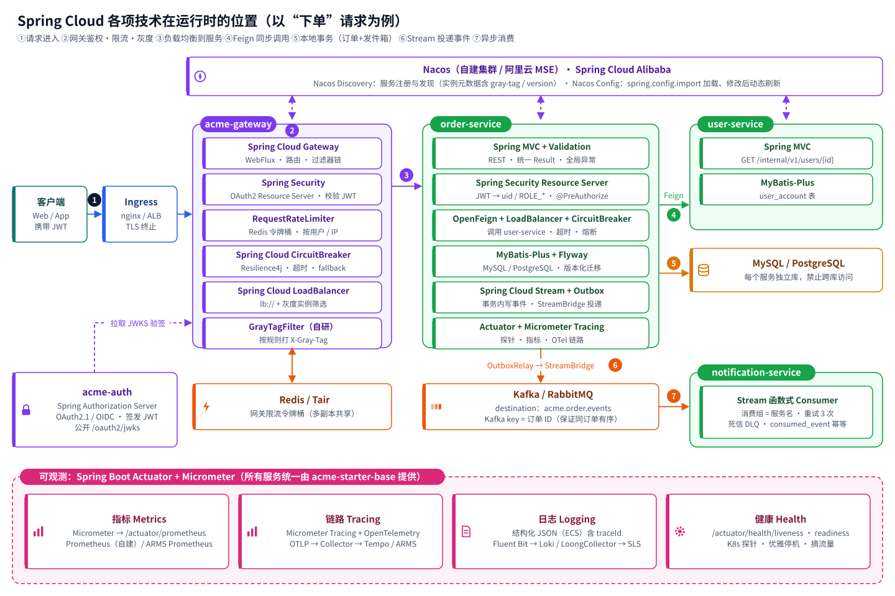

# 中大型微服务系统架构说明（Spring Cloud 版 / Go 版）

运行在 **Kubernetes** 上的中大型微服务系统参考架构，数据库 **MySQL / PostgreSQL** 二选一，消息 **Kafka / RabbitMQ** 二选一。
同一套架构设计提供两种技术栈实现，两个版本的环境规划、部署方案、接口约定、交付流程完全一致：

| | Spring Cloud 版 | Go 版 |
| --- | --- | --- |
| 技术栈 | Java 21 · Spring Boot 4.0.9 · Spring Cloud 2025.1.4 · Spring Cloud Alibaba 2025.1.0.0 | Go 1.26 · Kratos 2.9.2 · gRPC · nacos-sdk-go 2.3.5 · Watermill 1.5 · GORM 1.31 |
| 文档（Markdown） | [`docs/`](docs) | [`docs-go/`](docs-go) |
| 文档（HTML，单文件可离线打开） | [`html/index.html`](html/index.html) | [`html/go.html`](html/go.html) |
| 初始工程 | [`acme-cloud/`](acme-cloud)：Maven 多模块，30 个测试 | [`acme-go/`](acme-go)：单一 Go module，19 个测试函数，golangci-lint / buf lint 0 问题 |

> 📘 HTML 版内置目录导航与版本切换，所有图表为矢量图，点击可全屏放大查看（100%~300%）。



## 文档目录

| 章节 | Spring Cloud 版 | Go 版 |
| --- | --- | --- |
| 第 1 章 运行架构 | [测试 / 预发布 / 生产环境规划；方案 A 全自建、方案 B 阿里云；AWS / Azure；高可用、发布、灰度、回滚](docs/01-runtime-architecture.md) | [同左，另含 Go 版运行差异（镜像、启动、内存、端口、探针）](docs-go/01-runtime-architecture.md) |
| 第 2 章 技术落地 | [Nacos、Gateway、OpenFeign + LoadBalancer、CircuitBreaker、Stream + Outbox、Authorization Server、可观测](docs/02-spring-cloud-in-practice.md) | [框架选型、Spring Cloud → Go 逐项对照、Nacos、Go 网关、gRPC + Protobuf、熔断、Watermill + Outbox、认证、可观测、两版互通](docs-go/02-go-stack-in-practice.md) |
| 第 3 章 团队规范 | [拆分与命名、分支、分层、API / 错误码、调用、数据库、消息、配置、日志、安全、测试、部署、评审清单](docs/03-team-conventions.md) | [工程布局、分层、Protobuf、Go 编码、并发、调用、GORM、测试、工具链、评审清单](docs-go/03-team-conventions.md) |
| 第 4 章 初始代码结构 | [模块全景、目录树、starter、关键代码、本地开发、新增服务](docs/04-code-structure.md) | [模块全景、目录树、pkg 平台库、关键代码、本地开发、新增服务](docs-go/04-code-structure.md) |

## 架构图一览

| 图 | Spring Cloud 版 | Go 版 |
| --- | --- | --- |
| 环境规划与发布晋级 | [environments.svg](docs/images/environments.svg) | [environments.svg](docs-go/images/environments.svg) |
| 方案 A：全自建 | [arch-selfhosted.svg](docs/images/arch-selfhosted.svg) | [arch-selfhosted.svg](docs-go/images/arch-selfhosted.svg) |
| 方案 B：阿里云 | [arch-aliyun.svg](docs/images/arch-aliyun.svg) | [arch-aliyun.svg](docs-go/images/arch-aliyun.svg) |
| AWS / Azure | [arch-aws-azure.svg](docs/images/arch-aws-azure.svg) | [arch-aws-azure.svg](docs-go/images/arch-aws-azure.svg) |
| 组件选型对照 | [cloud-mapping.svg](docs/images/cloud-mapping.svg) | [cloud-mapping.svg](docs-go/images/cloud-mapping.svg) |
| 组件运行时分布 | [spring-cloud-landscape.svg](docs/images/spring-cloud-landscape.svg) | [go-landscape.svg](docs-go/images/go-landscape.svg) |
| 服务内部分层 | [service-layers.svg](docs/images/service-layers.svg) | [service-layers.svg](docs-go/images/service-layers.svg) |
| 代码模块与依赖 | [code-modules.svg](docs/images/code-modules.svg) | [code-modules.svg](docs-go/images/code-modules.svg) |

## 快速开始

```bash
# Spring Cloud 版
cd acme-cloud && mvn verify                       # 编译 + 30 个测试（无需外部中间件）

# Go 版
cd acme-go && make test                           # go test -race ./...（无需外部中间件）

# 本地中间件（两个版本相同）
docker compose -f acme-cloud/deploy/local/docker-compose.yml up -d
```

## 仓库结构

```text
.
├── README.md
├── docs/  · docs-go/        # Markdown 版文档（GitHub 直接渲染，含 Mermaid 图）及各自的 images/
├── html/                    # HTML 版文档：index.html（Spring Cloud 版）、go.html（Go 版）
├── acme-cloud/              # Spring Cloud 初始工程（Maven 多模块 + deploy/）
├── acme-go/                 # Go 初始工程（Go module + deploy/）
└── tools/
    ├── diagrams/            # 架构图生成脚本（Python）
    └── doc-site/            # HTML 版生成脚本（Markdown → 单文件 HTML，预渲染 Mermaid）
```

## 文档维护

```bash
python3 tools/diagrams/build_diagrams.py        # 重新生成 docs/images 与 docs-go/images 下的 SVG
cd tools/doc-site && npm ci && npm run build    # 重新生成 html/index.html 与 html/go.html（需要 Chromium 预渲染 Mermaid）
```
