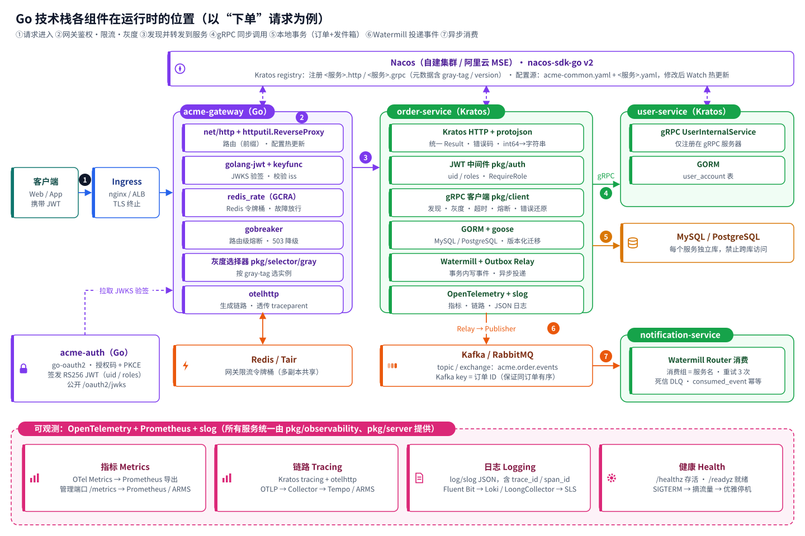
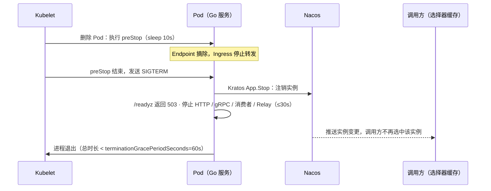
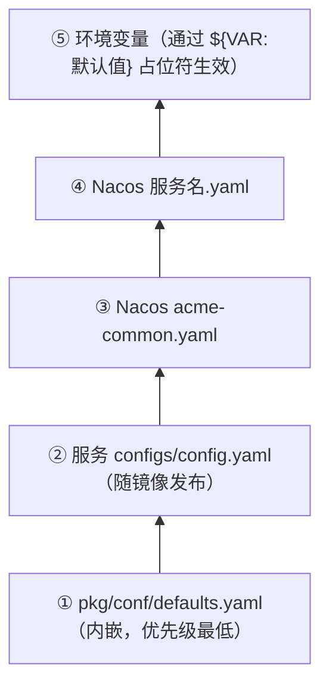
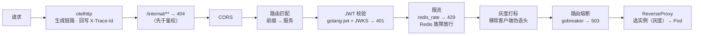
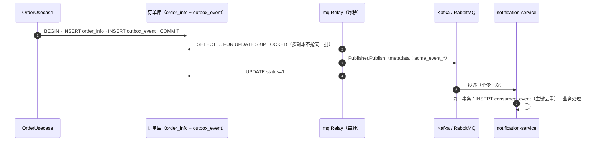
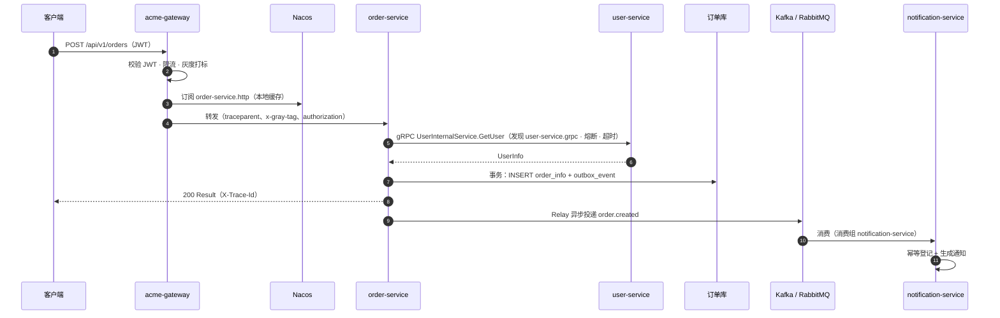

# 第 2 章 Go 技术栈在整套环境中的体现

> 本章逐项说明 Go 技术栈中每一项技术**用在哪里、为什么这样选、在不同环境中有何差异**，并给出初始工程 `acme-go/` 中对应的代码位置。
> 每一项都对应 [Spring Cloud 版第 2 章](../docs/02-spring-cloud-in-practice.md) 中的一项能力，两套实现遵循同一套接口约定，可以混合部署（见 2.16）。

## 2.1 版本基线

| 组件 | 版本 | 用途 |
| --- | --- | --- |
| Go | **1.26** | 语言与工具链（`go.mod` 中 `go 1.26.0`） |
| Kratos | **v2.9.2** | 微服务框架：HTTP / gRPC 传输、中间件、服务发现、选择器、配置、应用生命周期 |
| gRPC / Protobuf | grpc 1.84 · protobuf 1.36 | 服务间通信与接口契约；buf 1.57 管理代码生成与兼容性检查 |
| nacos-sdk-go | **v2.3.5** | 注册中心（Kratos contrib registry）与配置中心（自研配置源） |
| GORM + goose | gorm 1.31 · goose 3.29 | 数据访问与按方言分目录的版本化迁移 |
| Watermill | **v1.5.3**（kafka v3.1.4 · amqp v3.1.0） | 消息抽象：Kafka / RabbitMQ 二选一，运行时切换 |
| OpenTelemetry | **v1.47** | 链路与指标（Prometheus 导出） |
| golang-jwt + keyfunc | jwt v5.3 · keyfunc v3.9 | JWT 校验，JWKS 自动刷新 |
| go-redis + redis_rate | v9.23 · v10.0 | 网关限流（GCRA 令牌桶） |
| gobreaker | v2.4 | 网关路由级熔断 |
| go-oauth2 | v4.6 | 认证中心（授权码 + PKCE、客户端凭证） |

**升级策略**：所有版本在 `acme-go/go.mod` 中统一锁定；依赖升级通过 Renovate / Dependabot 提 MR，CI 全量测试通过后合入。Go 每半年一个大版本，团队在新版本发布 1~2 个补丁版本后跟进升级。

## 2.2 框架选型

| 方案 | 特点 | 适合 |
| --- | --- | --- |
| **Kratos（本方案）** | B 站开源；Protobuf 驱动，一份 proto 同时生成 gRPC 与 HTTP 接口；中间件、注册发现、选择器、配置等抽象清晰；官方 Nacos 扩展；推荐的 `service / biz / data` 分层与 DDD 契合 | 需要清晰分层、gRPC + HTTP 双协议、团队规模较大 |
| go-zero | 好未来开源；goctl 代码生成能力强，内置限流、熔断、缓存；国内社区活跃 | 偏重快速交付、愿意接受其约定的团队 |
| CloudWeGo（Kitex + Hertz） | 字节开源；Kitex 性能极高、Thrift / Protobuf 均支持，Hertz 为 HTTP 框架 | 超大流量、对性能有极致要求 |
| 标准库 + 精选库 | 无框架绑定，最灵活 | 小团队、服务数量少 |

选择 Kratos 的原因：它的抽象与 Spring Cloud 一一对应（registry ↔ DiscoveryClient、selector ↔ LoadBalancer、middleware ↔ Filter / Interceptor、config ↔ Environment），从 Java 迁移过来的团队理解成本最低；同时保持“小内核 + 可替换组件”，平台库 `pkg/` 可以按团队规范封装。

## 2.3 Spring Cloud → Go 能力对照

| 能力 | Spring Cloud 版 | Go 版 | Go 版代码位置 |
| --- | --- | --- | --- |
| 注册发现 | Spring Cloud Alibaba Nacos Discovery | Kratos registry（`contrib/registry/nacos`，nacos-sdk-go v2） | `pkg/registry` |
| 配置中心 | Nacos Config（`spring.config.import`） | 分层配置加载 + 自研 Nacos 配置源（Watch 热更新） | `pkg/conf` |
| 平台默认配置 | `EnvironmentPostProcessor` + `defaults/*.yml` | 内嵌 `defaults.yaml`，优先级最低 | `pkg/conf/defaults.yaml` |
| API 网关 | Spring Cloud Gateway | Go 网关（`net/http` + `httputil.ReverseProxy`） | `app/gateway` |
| 服务调用 | OpenFeign（HTTP `/internal/**`） | gRPC（`*InternalService`），Protobuf 契约 | `pkg/client`、`api/` |
| 负载均衡 + 灰度 | Spring Cloud LoadBalancer + 自研 Supplier | Kratos 选择器（默认加权轮询 WRR，可换 P2C）+ 灰度 `NodeFilter` | `pkg/selector/gray` |
| 熔断 | Spring Cloud CircuitBreaker（Resilience4j） | 服务间：Kratos 熔断中间件（Google SRE 自适应算法）；网关：gobreaker | `pkg/client`、`app/gateway` |
| 消息驱动 | Spring Cloud Stream（Kafka / RabbitMQ Binder） | Watermill（Kafka / RabbitMQ Pub/Sub） | `pkg/mq` |
| 事务发件箱 | `OutboxPublisher` + `OutboxRelay` | `mq.Outbox` + `mq.Relay` | `pkg/mq/outbox.go` |
| 消费幂等 | `IdempotentConsumer` | `mq.Idempotent` | `pkg/mq/consumer.go` |
| 认证中心 | Spring Authorization Server | go-oauth2（生产推荐 Casdoor / Keycloak / IDaaS） | `app/auth` |
| 资源服务器 | Spring Security OAuth2 Resource Server | Kratos JWT 中间件 + JWKS | `pkg/auth` |
| 统一响应 / 错误码 | `Result` + `GlobalExceptionHandler` | Kratos `ResponseEncoder` / `ErrorEncoder` + `errorx` | `pkg/result`、`pkg/errorx` |
| 数据访问 | MyBatis-Plus + Flyway | GORM + goose | `pkg/database` |
| 指标 / 链路 / 日志 | Micrometer + OTel + 结构化日志 | OpenTelemetry + Prometheus 导出 + `log/slog` | `pkg/observability` |
| 健康检查 | Actuator 探针 | 管理端口 `/healthz`、`/readyz`、`/metrics` | `pkg/server/management.go` |
| 分层约束 | ArchUnit | `archtest`（解析导入关系） | `pkg/archtest` |
| 测试支撑 | `@AcmeServiceTest`（H2 + Test Binder） | `testkit`（SQLite + gochannel + 本地 JWT） | `pkg/testkit` |

## 2.4 全景：一次请求经过哪些组件



| 能力 | 方案 A 自建 | 方案 B 阿里云 |
| --- | --- | --- |
| 注册 + 配置 | Nacos 3 节点集群 | MSE Nacos |
| 网关入口 | ingress-nginx → acme-gateway | ALB Ingress → acme-gateway（可选 MSE 云原生网关） |
| 数据库 | MySQL InnoDB Cluster / PostgreSQL + Patroni | RDS / PolarDB |
| 消息 | Kafka（Strimzi）/ RabbitMQ | 云消息队列 Kafka 版 / RabbitMQ 版 |
| 限流存储 | Redis Sentinel | Tair |
| 链路 / 指标 / 日志 | OTel Collector → Tempo · Prometheus · Loki | ARMS · ARMS Prometheus · SLS |

## 2.5 服务注册与发现：Nacos

### 2.5.1 注册方式

服务启动后，Kratos 应用把每个传输端点注册为一个 Nacos 服务（实现见 `contrib/registry/nacos`）：

| Nacos 服务名 | 端点 | 发现方 |
| --- | --- | --- |
| `order-service.http` | `http://<PodIP>:8080` | 网关 |
| `order-service.grpc` | `grpc://<PodIP>:9090` | 其它服务的 gRPC 客户端 |

实例元数据（`pkg/registry.Metadata`）：`gray-tag`（灰度标签，来自 `GRAY_TAG`）、`version`（镜像 tag）、`zone`（可用区）。

### 2.5.2 为什么在 K8s 上仍然使用 Nacos

理由与 Spring Cloud 版一致：灰度需要实例元数据、跨集群 / 混合部署需要统一注册中心、配置中心需要审批与灰度发布能力，并且阿里云 MSE 提供托管。Go 版额外的好处是：**与 Spring Cloud 服务注册到同一个 Nacos 后可以互相发现**（服务名规则不同，见 2.16）。

不想维护 Nacos 时（如 AWS / Azure）：把 `pkg/registry` 换成 Kratos 的 kubernetes registry，或直接使用 Headless Service DNS（`dns:///order-service-grpc.acme.svc:9090`）；配置改为 ConfigMap 文件源。业务代码不受影响。

### 2.5.3 优雅上下线



## 2.6 配置：分层加载与热更新

### 2.6.1 优先级



```yaml
# pkg/conf/defaults.yaml（节选）
nacos:
  enabled: ${NACOS_ENABLED:true}
  addr: ${NACOS_SERVER_ADDR:127.0.0.1:8848}
  namespace: ${NACOS_NAMESPACE:}        # 命名空间 = 环境
server:
  http:
    addr: ${HTTP_ADDR:0.0.0.0:8080}
  management:
    addr: ${MANAGEMENT_ADDR:0.0.0.0:8081}
client:
  timeout: 3s                           # 服务间调用默认超时
```

每个服务的配置结构体内嵌 `pconf.Bootstrap`，`pconf.Load` 按上图顺序合并后扫描到结构体：

```go
var c conf.Config // struct{ pconf.Bootstrap; Consumer Consumer }
cfg, err := pconf.Load("configs/config.yaml", &c, func() *pconf.Bootstrap { return &c.Bootstrap })
```

`TestLoadPrecedence` 覆盖了这套优先级。

### 2.6.2 热更新

Nacos 配置变更会推送到 `config.Config`，服务按需 `Watch` 某个配置段。网关的路由、灰度、限流、熔断参数就是这样热更新的：

```go
cfg.Watch("gateway", func(_ string, v config.Value) {
    var next conf.Gateway
    if err := v.Scan(&next); err == nil {
        gw.Update(next)          // 原子替换，进行中的请求不受影响
    }
})
```

> Kratos 官方的 Nacos 配置扩展仍依赖 nacos-sdk-go v1，而注册中心扩展已经是 v2。为了只引入一套 SDK，`pkg/conf/nacos.go` 用 v2 SDK 实现了约 60 行的配置源。

### 2.6.3 配置放在哪里

与 Spring Cloud 版相同：平台默认值在 `pkg/conf`，服务固定配置在 `configs/config.yaml`，动态业务配置在 Nacos，部署形态在 GitOps values，凭据在 K8s Secret（来自 Vault / KMS），基础设施地址在 platform-env ConfigMap。**不使用环境名区分配置文件**，镜像在所有环境中一致。

## 2.7 API 网关

代码：`acme-go/app/gateway`

### 2.7.1 为什么自研一个 Go 网关

Go 生态没有与 Spring Cloud Gateway 同等地位的“框架内网关”，常见做法有两种：使用 APISIX / Higress / Kong 等独立网关产品，或用标准库写一个精简网关。本方案选择后者（约 400 行），因为：

- 鉴权、灰度、错误码与业务服务共用 `pkg/auth`、`pkg/selector/gray`、`pkg/result`，规则只写一份；
- 网关逻辑和业务代码一起评审、测试、发布；
- 需要更强的流量治理（WAF 插件、插件市场、可视化）时，可以平滑切换到 **APISIX / Higress**（阿里云 MSE 云原生网关基于 Higress），把 JWT 校验、限流迁过去，Go 网关只保留灰度与业务路由，或整体下线。

### 2.7.2 处理链



### 2.7.3 配置

```yaml
gateway:                       # 建议放在 Nacos 的 acme-gateway.yaml，修改即时生效
  routes:
    - { id: order-service, prefix: /api/v1/orders, service: order-service }
  publicPrefixes: [/api/v1/public/]
  rateLimit: { enabled: true, perSecond: 20, burst: 40 }
  breaker:   { minRequests: 50, failureRatio: 0.5, openTimeout: 10s, interval: 60s }
  gray:      { enabled: true, tag: v2, uids: ["1001"], percentage: 5, allowClientHeader: false }
```

`gateway_test.go` 覆盖了：`/internal` 屏蔽（未登录也是 404）、401、未知路由、灰度白名单、伪造灰度头无效、令牌与灰度标签透传、无实例降级、熔断打开、限流与 Redis 故障放行。

## 2.8 服务调用：gRPC + Protobuf

### 2.8.1 契约

接口契约放在 `api/<领域>/v1/*.proto`，一份 proto 同时生成：

- `*_grpc.pb.go`：gRPC 服务端接口与客户端；
- `*_http.pb.go`：Kratos HTTP 路由（来自 `google.api.http` 注解），用于对外 REST；
- `*.pb.go`：消息类型（也用作事件载荷）。

```protobuf
// 对外：经网关 /api/v1/users/**
service UserService {
  rpc GetUser(GetUserRequest) returns (UserReply) {
    option (google.api.http) = {get: "/api/v1/users/{id}"};
  }
}
// 集群内：只注册在 gRPC 服务器上，网关不可达
service UserInternalService {
  rpc GetUser(GetUserRequest) returns (UserInfo);
}
```

`buf lint` 保证风格统一，`buf breaking` 在 CI 中与 `main` 比较，禁止删除字段、修改字段编号等破坏性变更（对应 Java 版“xxx-api 只做向后兼容修改”的约定）。

### 2.8.2 客户端

```go
conn, err := client.Dial(ctx, discovery, c.Client, "user-service") // 发现 user-service.grpc
users := userv1.NewUserInternalServiceClient(conn)
```

`pkg/client` 的中间件链（顺序有意义）：

| 顺序 | 中间件 | 作用 |
| --- | --- | --- |
| 1 | recovery | 防止 panic 扩散 |
| 2 | tracing | 注入 `traceparent`，链路贯穿 |
| 3 | metadata | 透传 `x-gray-tag`、`authorization`、`x-md-*` |
| 4 | remoteErrors | 还原下游错误：4xx 业务错误码原样返回；熔断 / 不可用 / 超时 → `C0503`；其它 → `C0001` |
| 5 | circuitbreaker | Kratos SRE 自适应熔断，只统计 5xx / 超时，4xx 业务错误不会打开熔断器 |

另外通过 `WithNodeFilter(gray.Filter())` 按请求的灰度标签筛选实例，`WithTimeout` 设置默认超时（3s，按下游调整）。本地开发未启用 Nacos 时，按 `client.endpoints` 直连。

### 2.8.3 错误在服务间如何传递

Kratos 错误同时携带 HTTP 状态（`Code`）与业务错误码（`Reason`）。经 gRPC 传输时放在 `ErrorInfo` 中，调用方 `errors.FromError` 即可原样还原，无需像 Feign 那样解析响应体。冒烟测试验证了这条链路：user-service 返回 `404 A1001` → order-service 的防腐层翻译为 `422 A2002`；user-service 宕机 → `503 C0503`。

## 2.9 容错

| 位置 | 机制 | 关键参数 |
| --- | --- | --- |
| 网关路由 | gobreaker（失败率熔断） | 最近 60s 请求数 ≥ 50 且失败率 ≥ 50% 打开，10s 后半开 |
| 服务间 gRPC | Kratos `circuitbreaker.Client`（Google SRE 自适应限流算法，按 operation 分组） | 根据成功率自动丢弃部分请求，无需手工阈值 |
| 超时 | `context` 截止时间（网关 10s、服务间 3s） | 下游超时向上游传递，避免“等待已经无人关心的结果” |
| 重试 | 只对幂等读请求重试；写请求依靠幂等键 + 客户端重试 | 不在多层同时重试，避免放大流量 |

阿里云上也可接入 **MSE 服务治理**（支持 Go 应用）获得控制台化的流控与全链路灰度，与代码内熔断二选一，不要叠加。

## 2.10 消息驱动：Watermill

### 2.10.1 驱动选择

`MQ_DRIVER` 在运行时选择（同一个镜像同时包含两种驱动）：

| 驱动 | 发布 | 消费组 |
| --- | --- | --- |
| `kafka` | Sarama 幂等生产者（acks=all），消息 key = `acme_event_key` | Kafka consumer group = 服务名 |
| `rabbitmq` | 每个 topic 一个 fanout 交换机 | 每个消费组一个持久化队列 `<topic>_<服务名>` |
| `gochannel` | 进程内总线，仅测试使用 | — |

> 与 Java 版的差异：Spring Cloud Stream 的 RabbitMQ Binder 以事件类型作为 routing key，消费者只绑定关心的类型；Watermill 的 AMQP 适配器按 topic 生成 routing key，因此 Go 版使用 fanout，消费者按 `acme_event_type` 头过滤（与 Kafka 的处理方式相同）。

### 2.10.2 发布：事务发件箱

```go
// biz：远程调用在事务外，订单与事件在同一事务内
err = uc.tx.InTx(ctx, func(ctx context.Context) error {
    if err := uc.repo.Add(ctx, o); err != nil {
        return err
    }
    return uc.events.OrderCreated(ctx, o) // data 层：mq.Outbox.Publish（不在事务内会直接报错）
})
```



`mq.Relay` 实现了 Kratos 的 `transport.Server`，与 HTTP / gRPC 服务器一起由应用管理启停。

### 2.10.3 消费：重试、死信、幂等

```go
router, _ := mq.NewRouter(dlqPublisher, mq.RouterConfig{DLQTopic: "acme.order.events.notification-service.dlq"})
router.AddConsumerHandler("order-created", orderv1.EventsTopic, subscriber, consumer.Handle)
// consumer.Handle：先按 acme_event_type 过滤，再交给 mq.Idempotent 在事务内“登记 + 处理”
```

中间件顺序：死信（最外层）→ 指数退避重试（默认 3 次）→ panic 恢复 → 业务。`TestConsumeOrderCreatedExactlyOnceAndDeadLetter` 验证了重复消息只处理一次、其它事件类型被忽略、无法解析的消息重试后进入死信。

### 2.10.4 事件头与载荷

事件头与 Java 版完全相同：`acme_event_id`、`acme_event_type`、`acme_event_source`、`acme_event_time`、`acme_event_key`。载荷是 protojson 编码的 proto 消息（如 `OrderCreated`），字段为小驼峰，消费方使用 `DiscardUnknown` 容忍新增字段。

## 2.11 分布式事务

原则与 Spring Cloud 版相同：优先从业务上避免，其次 Outbox + 幂等 + 补偿（本工程内置），长流程用 Saga。确实需要跨库强一致时，Go 生态可选 **DTM**（Go 编写，支持 Saga / TCC / XA / 二阶段消息），或 Seata 的 Go 客户端（seata-go）。引入前需评审。

## 2.12 认证与授权

| 角色 | 实现 |
| --- | --- |
| 认证中心 | `app/auth`：go-oauth2 v4，授权码 + PKCE（公共客户端 `acme-web`）、客户端凭证（`acme-internal`）；签发 RS256 JWT，含 `uid`、`roles`、`scope`；提供 `/oauth2/jwks` 与 `/.well-known/openid-configuration` |
| 网关 | 校验签名、过期、`iss`，未登录在边缘拒绝 |
| 服务 | `pkg/auth.Server`：Kratos JWT 中间件 + JWKS（keyfunc 后台刷新）+ `iss` 校验；业务代码用 `auth.UID(ctx)`、`auth.RequireRole(ctx, "ADMIN")` |
| 服务间 | 用户上下文中的 gRPC 调用透传 `authorization`，下游再次校验；后台任务使用客户端凭证令牌 |

`app/auth` 是一个精简实现，便于本地与测试环境自包含运行。生产推荐使用成熟 IdP：**Casdoor**（Go）、**Ory Hydra**（Go）、Keycloak、阿里云 IDaaS、Amazon Cognito、Microsoft Entra ID。只要签发的 JWT 带有 `uid` / `roles` 声明并公开 JWKS，网关与服务无需改动（Java 版与 Go 版的资源服务可以共用同一个认证中心）。

## 2.13 可观测性

| 支柱 | 实现 | 自建 | 阿里云 |
| --- | --- | --- | --- |
| 指标 | Kratos metrics 中间件 → OTel Metrics → Prometheus 导出（请求计数 `server_requests_code_total` 与耗时直方图 `server_requests_seconds_bucket_*`，标签含 operation、code、reason）+ Go 运行时指标 | Prometheus + Grafana | ARMS Prometheus |
| 链路 | Kratos tracing 中间件 + 网关 otelhttp，OTLP/HTTP 上报；gRPC 元数据自动传播 | OTel Collector → Tempo | ARMS 可观测链路 |
| 日志 | `log/slog` JSON（`LOG_FORMAT=json`），自动带 `trace_id`、`span_id`、`service`、`env`、`version`；访问日志 4xx 记 INFO、5xx 记 ERROR | Fluent Bit → Loki | LoongCollector → SLS |
| 健康 | 管理端口 `/healthz`、`/readyz`（检查数据库），停机开始后 `/readyz` 返回 503 | K8s 探针 | K8s 探针 |

响应头与响应体都带 `traceId`，用户反馈问题时可直接定位到整条链路。

## 2.14 “下单”请求全链路时序



## 2.15 其它常用能力的选型建议

| 能力 | 建议 |
| --- | --- |
| 依赖注入 | 组装代码手写在 `internal/server`（显式、可读）；服务很多时可用 uber/fx。Kratos 模板常用的 google/wire 已归档，新项目不建议引入 |
| 参数校验 | 简单规则在 service 层手写；规则多时使用 protovalidate（在 proto 中声明约束） |
| 定时任务 | XXL-JOB（有 Go 执行器）或 SchedulerX；批处理用 K8s CronJob；服务内轻量任务用 ticker + Redis 分布式锁 |
| 缓存 | go-redis + `singleflight` 防击穿；缓存 key 带服务前缀，必须设置过期时间 |
| 分布式锁 | redsync（或数据库唯一约束 / 乐观锁，优先后者） |
| 文件 | minio-go / 阿里云 OSS SDK / AWS SDK，统一按 S3 兼容接口封装 |
| 搜索 | go-elasticsearch，通过事件异步同步 |
| 并发 | 每个 goroutine 都要有退出路径（`context` 取消）；批量并发用 `errgroup` 并限制并发度 |

## 2.16 与 Spring Cloud 版互通

两套实现遵循同一套约定，可以在同一套环境中混合部署（例如存量 Java 服务 + 新增 Go 服务）：

| 约定 | 是否一致 | 说明 |
| --- | --- | --- |
| Nacos 命名空间 / 分组 | 一致 | 两边都注册到同一个 Nacos |
| 服务名 | **不同** | Java 注册为 `order-service`，Go 注册为 `order-service.http` / `.grpc`。网关需要按实现类型配置路由；Java 服务调用 Go 服务时走网关或在 Go 服务额外暴露 HTTP 内部接口 |
| 统一响应体 / 错误码 | 一致 | `{code, message, data, traceId}`，A/B/C 错误码与号段规则相同 |
| JWT 声明 | 一致 | `uid`、`roles`、`scope`，两边可共用同一个认证中心 |
| 灰度 | 一致 | 实例元数据 `gray-tag` + 请求头 `x-gray-tag` |
| 事件头 / Topic | 一致 | `acme_event_*`、`acme.<领域>.events` |
| 事件载荷 | **注意** | Go 的 protojson 把 int64 编码为字符串（Jackson 可直接读取）；金额字段 Go 版为字符串、Java 版为数值。混合部署时应在事件契约中统一金额为字符串，或用 proto 定义跨语言共享的事件契约 |
| 内部调用协议 | **不同** | Java 用 HTTP `/internal/**`，Go 用 gRPC |

## 2.17 各项技术在三套环境中的差异汇总

| 技术 | 测试 test | 预发布 staging | 生产 prod |
| --- | --- | --- | --- |
| Nacos | 非生产集群 · 命名空间 `test` | 命名空间 `staging` | 独立集群 · 命名空间 `prod` · 配置变更审批 |
| 网关 | 允许客户端指定 `x-gray-tag` | 关闭客户端灰度头 | 灰度规则由 Nacos 控制（白名单 + 百分比） |
| 限流阈值 | 宽松 | 同生产 | 按容量评估 |
| 服务间超时 / 熔断 | 同生产 | 同生产 | 基线值，按接口调优 |
| 消息 | 单节点；本地可自动建 topic | 高可用；平台建 topic | 高可用；平台建 topic；DLQ 告警 |
| 认证 | 演示账号可用 | 演示账号关闭 | 演示账号关闭；JWK 私钥来自 KMS / Vault |
| 链路采样 | 100% | 100% | 10% |
| 日志级别 | debug | info | info |
| 数据库迁移 | 启动时执行 | 启动时执行 | 启动时执行；大表变更或需审批时改为发布前的 K8s Job 执行，服务设置 `DB_MIGRATE=false` |
