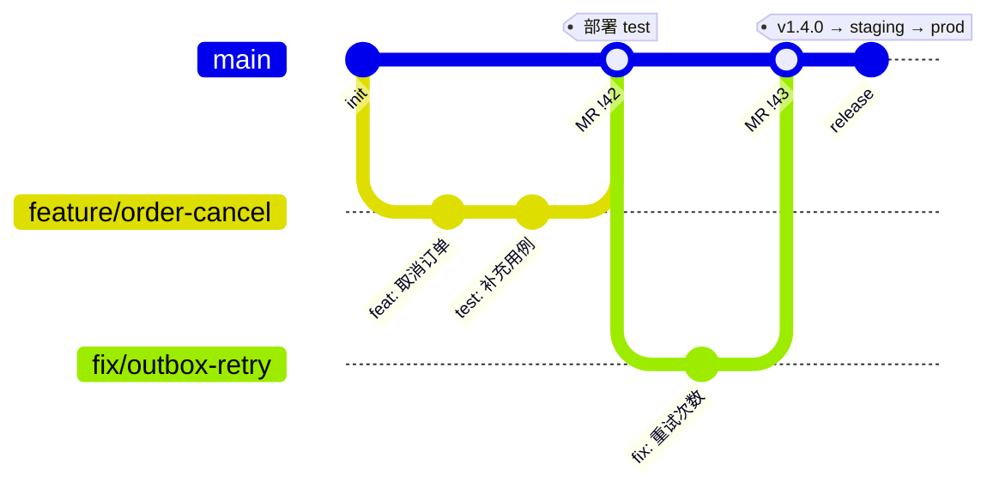
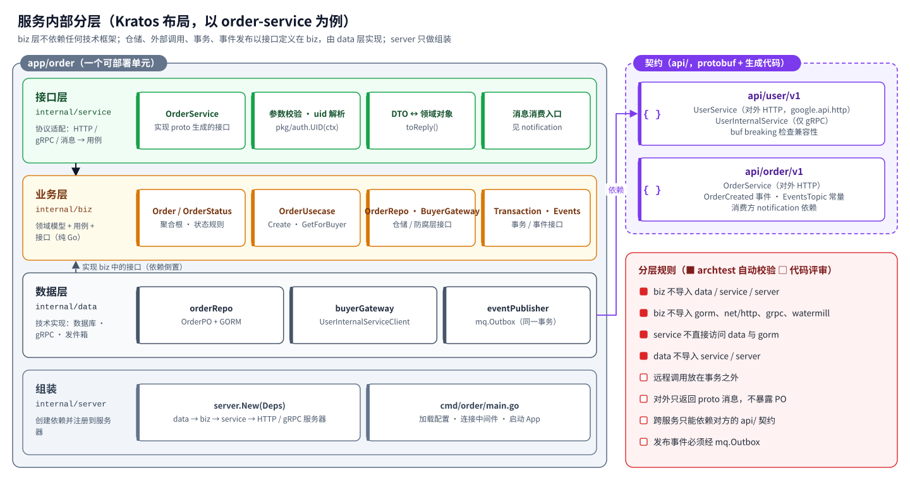

# 第 3 章 Go 团队开发规范

> 规范的目标是让 30~100 人、10~50 个服务的团队写出“看起来像一个人写的”代码。
> 能自动化的规范都已经固化在初始工程里（平台库默认值、分层检查、CI 检查）；本章说明**为什么**以及**自动化覆盖不到的部分**。
> 标记说明：🔒 由工程或 CI 强制；👀 代码评审检查。

## 3.1 服务拆分与命名

### 3.1.1 拆分原则

- 按**业务能力 / 限界上下文**拆分（用户、订单、支付、库存、通知……），而不是按技术层拆分（不要出现 `dao-service`、`common-service`）；
- 一个服务由**一个团队**负责，一个团队可以负责多个服务；
- 一个服务**独占自己的数据库**，其它服务只能通过 API 或事件获取它的数据；
- 拆分粒度宁粗勿细：初期 5~10 个服务即可，出现明确的独立扩缩容、独立发布、团队边界需求时再拆。

### 3.1.2 命名对照表

| 对象 | 规则 | 示例 |
| --- | --- | --- |
| 服务名（`app.name`、K8s、Nacos 前缀） | `<领域>-service` | `order-service`（Nacos 中为 `order-service.http` / `.grpc`） |
| 代码目录 | `app/<领域>` | `app/order` |
| 可执行入口 | `app/<领域>/cmd/<领域>/main.go` | `app/order/cmd/order` |
| Go 包名 | 小写单词，不用下划线和复数 | `biz`、`data`、`gray`、`orderv1` |
| Proto 包 | `<领域>.v<n>`，`go_package` 别名 `<领域>v<n>` | `order.v1` / `orderv1` |
| 对外 / 集群内服务 | `<名称>Service` / `<名称>InternalService` | `UserService`、`UserInternalService` |
| 数据库 | `acme_<领域>` | `acme_order` |
| 表 | `<业务实体>`，单数，小写下划线；避开保留字 | `order_info`、`user_account` |
| Topic | `acme.<领域>.events` | `acme.order.events` |
| 事件类型 | `<领域>.<过去式动词>` | `order.created`、`order.cancelled` |
| 消费组 | 服务名 | `notification-service` |
| 死信 Topic | `<topic>.<消费组>.dlq` | `acme.order.events.notification-service.dlq` |
| Nacos Data ID | `<服务名>.yaml`；所有服务共享 `acme-common.yaml` | `order-service.yaml` |
| 错误码号段 | 每个服务 1000 个 | user `A1xxx`、order `A2xxx` |
| 本地端口 | 服务 HTTP 81xx、gRPC 91xx、管理 71xx；网关 8080、认证 9000；K8s 中统一 8080 / 9090 / 8081 | order：8102 / 9102 / 7102 |

## 3.2 仓库与分支

### 3.2.1 仓库策略

- **单仓单模块（本工程默认）**：`acme-go` 是一个 Go module，所有服务共享 `go.mod`，依赖版本天然一致，跨服务重构一次提交完成；CI 按变更路径只构建受影响的服务。
- 服务超过 30 个或团队跨组织时，可把 `pkg/` 拆成独立模块发布（SemVer tag），业务仓库通过 `go get` 依赖固定版本；`api/` 契约可单独成仓并用 buf 管理。

### 3.2.2 分支模型：主干开发 + 短分支



| 规则 | 说明 |
| --- | --- |
| `main` 永远可发布 🔒 | 受保护分支，只能通过 MR 合入；CI（格式、`go vet`、golangci-lint、`buf lint` / `buf breaking`、`go test -race`）必须通过 |
| 短分支 | `feature/*`、`fix/*`，生命周期 ≤ 3 天；未完成功能用功能开关（Nacos 配置）隐藏 |
| Code Review 🔒 | 至少 1 人批准；涉及 `api/`、迁移脚本、`pkg/`、安全配置时需对应负责人批准（CODEOWNERS） |
| 提交信息 | Conventional Commits：`feat:`、`fix:`、`refactor:`、`test:`、`docs:`、`chore:`；可附 `(order)` 范围 |
| 版本 | 服务镜像以 Git SHA 标识；对外发布时打 tag `vX.Y.Z`；`pkg/` 独立发布时遵循 SemVer |
| 紧急修复 | 仍然走 `fix/*` → MR → `main`，通过 GitOps 快速晋级，**不在生产分支上直接修改** |

## 3.3 工程布局

```text
app/order/
├── cmd/order/main.go        # 入口：加载配置 → 连接中间件 → server.New → App.Run
├── configs/config.yaml      # 本服务配置（只写特有项）
├── migrations/              # goose 脚本：mysql/ postgres/ sqlite/（sqlite 仅测试）
├── internal/
│   ├── conf/                # 配置结构体（内嵌 pconf.Bootstrap）
│   ├── service/             # 接口层：实现 proto 接口、消息消费入口
│   ├── biz/                 # 业务层：领域模型、用例、仓储/网关/事务/事件接口、错误码
│   ├── data/                # 数据层：GORM 仓储、gRPC 下游适配、发件箱
│   └── server/              # 组装：data → biz → service → HTTP / gRPC 服务器
└── order_test.go            # 服务级集成测试 + 分层规则测试
```

- 服务代码全部放在 `internal/` 下，Go 编译器保证其它服务无法导入 🔒；服务间只能依赖 `api/`；
- 共用能力放 `pkg/`，由平台组维护，业务团队提 MR 评审后合入；
- 禁止出现 `common`、`util`、`helper` 这类含义模糊的包 👀。

## 3.4 分层规范



| 层 | 可以做 | 不可以做 |
| --- | --- | --- |
| service | 参数校验、`auth.UID(ctx)` 解析身份、proto ↔ 领域对象转换、调用用例 | 写业务规则、开启事务、导入 `internal/data` 或 `gorm.io` 🔒 |
| biz | 领域模型与规则、用例编排、定义仓储 / 网关 / 事务 / 事件接口、定义错误码 | 导入 `internal/data`、`internal/service`、`gorm.io`、`net/http`、`google.golang.org/grpc`、Watermill、Redis 🔒 |
| data | 实现 biz 中的接口：GORM 仓储、gRPC 下游适配（防腐层）、发件箱 | 导入 `internal/service`、`internal/server` 🔒；包含业务规则 👀 |
| server | 创建依赖、注册接口到服务器 | 写任何逻辑 👀 |

这些依赖规则由 `pkg/archtest.CheckLayers` 在每个服务的 `TestLayers` 中检查，违反即测试失败。

**接口定义在使用方**：`OrderRepo`、`BuyerGateway`、`Transaction`、`EventPublisher` 都定义在 `biz`（使用方），由 `data` 实现，这是 Go 中实现依赖倒置的惯用法。

> 简单 CRUD 服务也保持同样的目录结构，但允许“薄”：领域对象可以只是数据载体，用例直接调用仓储。一致的结构让任何人都能快速找到代码。

## 3.5 API 与 Protobuf 规范

### 3.5.1 契约

| # | 规则 |
| --- | --- |
| 1 | 所有接口先写 proto，再生成代码；生成代码与 proto 一起提交，CI 检查二者一致 🔒 |
| 2 | `buf lint`（STANDARD 规则）🔒；`buf breaking` 与 `main` 比较，禁止删除字段、修改字段编号或类型 🔒 |
| 3 | 字段名在 proto 中用 `snake_case`，JSON 输出为 `lowerCamelCase`（protojson 默认） |
| 4 | 对外接口用 `google.api.http` 注解，前缀 `/api/v<n>/`，资源复数名词，动作用子资源（`POST /api/v1/orders/{id}/cancel`）；集群内接口只定义为 `*InternalService`，不加 HTTP 注解，因此网关不可达 🔒 |
| 5 | 不兼容变更升级版本号（`order.v2`），旧版本至少保留一个发布周期；字段只增不删，废弃字段标注 `reserved`，不复用编号 |

### 3.5.2 统一响应与错误码

所有对外 HTTP 接口返回统一响应体，**同时**使用与错误码一致的 HTTP 状态码 🔒（`pkg/result`）：

```json
{ "code": "A2002", "message": "下单用户不存在或已被禁用", "data": null, "traceId": "4bf92f3577b34da6a3ce929d0e0e4736" }
```

| 规则 | 说明 |
| --- | --- |
| 错误码格式 | 5 位：首字母 `A` 调用方错误 / `B` 本系统错误 / `C` 第三方或下游错误，后 4 位数字；成功为 `00000` |
| 号段 | 平台 `0000-0999`（`pkg/errorx`）；每个服务 1000 个号段，在服务 `biz` 中以 `errorx.Code` 变量定义 |
| HTTP 状态 | 由错误码定义：400 参数、401 未认证、403 无权限、404 不存在、409 冲突、422 业务规则不满足、429 限流、5xx 系统错误；成功统一 200 |
| 业务失败 | 返回 `biz.ErrXxx.New(args...)` 或 `errorx.BadRequest.Msg("...")`；不要把 `fmt.Errorf` 字符串错误直接返回给调用方 👀 |
| 未知错误 | 统一返回 `B0001`，不暴露内部信息；原始错误由中间件以 ERROR 记录一次 🔒 |
| traceId | 响应体与响应头 `X-Trace-Id` 都带上，便于用户反馈定位 |

### 3.5.3 数据格式

| 项目 | 规则 |
| --- | --- |
| ID | int64 在 JSON 中输出为字符串（protojson 默认，避免 JS 精度丢失） 🔒 |
| 金额 | 字符串表示的十进制数（如 `"99.80"`），服务内用 `shopspring/decimal` 计算，数据库 `DECIMAL(18,2)` / `NUMERIC(18,2)` |
| 时间 | `google.protobuf.Timestamp`，JSON 为 RFC 3339；服务内统一 UTC |
| 枚举 | 输出字符串名（`CREATED`），不输出序号 |
| 分页 | 请求 `page_no`（从 1 开始）、`page_size`（≤100）；响应 `total`、`page_no`、`page_size`、`records` |
| 敏感信息 | 手机号、身份证、银行卡在响应中脱敏（`138****1234`） |
| 写接口幂等 | 客户端可传 `Idempotency-Key` 请求头；创建类接口在服务端通过唯一约束或幂等表去重 |

## 3.6 Go 编码规范

| # | 规则 |
| --- | --- |
| 1 | `gofmt` / `goimports` 格式化 🔒；`go vet` 与 `golangci-lint`（`.golangci.yml`）通过 🔒 |
| 2 | `context.Context` 作为第一个参数并逐层传递，不保存到结构体，不传 `nil` |
| 3 | 错误必须处理；包装时用 `fmt.Errorf("...: %w", err)` 保留错误链，判断用 `errors.Is / As` 🔒（errorlint） |
| 4 | 不在库代码中 `panic`；服务入口与中间件有 `recovery` 兜底 |
| 5 | 不使用全局可变状态与 `init()` 副作用；依赖通过构造函数显式传入（组装集中在 `internal/server`） |
| 6 | 导出的标识符写注释；注释说明“为什么”，而不是复述代码 |
| 7 | 接口小而专注（1~3 个方法），定义在使用方；返回具体类型，接收接口 |
| 8 | 资源（`rows`、`resp.Body`、文件）用 `defer` 关闭 🔒（bodyclose、sqlclosecheck）；进程退出前的清理统一交给 `pserver.Cleanup` |

## 3.7 并发规范

| # | 规则 |
| --- | --- |
| 1 | 每个 goroutine 都要有明确的退出条件（`ctx.Done()` 或通道关闭），不允许“发射后不管” 👀 |
| 2 | 长期运行的后台任务（发件箱投递、消费者、定时任务）实现 `transport.Server`，交给 Kratos App 管理启停（参考 `mq.Relay`、`mq.Router`） |
| 3 | 并发处理一批任务用 `errgroup` 并设置并发上限（`SetLimit`），禁止无界创建 goroutine |
| 4 | 共享数据优先用通道或 `sync/atomic`（如网关用 `atomic.Pointer` 热更新配置）；必须加锁时锁的范围尽量小，不在持锁时做 I/O |
| 5 | 测试统一带 `-race` 运行 🔒 |

## 3.8 服务间调用规范

| # | 规则 |
| --- | --- |
| 1 | 只依赖对方 `api/` 中的 gRPC 客户端，禁止复制对方的结构体或手写 HTTP 调用 👀 |
| 2 | 连接通过 `pkg/client.Dial` 创建（发现、灰度、超时、熔断、元数据透传、错误还原）🔒；默认超时 3s，按下游单独调整 |
| 3 | 下游调用放在数据库事务之外 👀（参考 `OrderUsecase.Create`） |
| 4 | 在 `data` 层做防腐适配，把下游错误翻译为本服务语义（参考 `buyerGateway`）👀 |
| 5 | 不在循环中逐条调用，提供批量接口；禁止服务间循环依赖，需要反向通知时用事件；同步调用链深度 ≤ 3 👀 |
| 6 | 一个服务进程内对同一下游只建一个 `*grpc.ClientConn`，在启动时创建、退出时关闭 |
| 7 | `*InternalService` 同样要校验参数，服务侧也校验 JWT 🔒 |

## 3.9 数据库规范

### 3.9.1 设计规则

| # | 规则 |
| --- | --- |
| 1 | 一服务一库，**禁止跨库访问与跨服务 JOIN** 🔒（数据库账号只授予本服务库） |
| 2 | 每张表必须包含公共字段：`id BIGINT` 主键、`created_at`、`updated_at`、`deleted`（逻辑删除）、`version`（乐观锁）🔒（PO 内嵌 `database.Model`） |
| 3 | 主键在应用侧生成（`database.NextID()`，Sonyflake），不使用自增，也不使用 UUID 字符串主键（索引离散）；应用侧生成便于在事务前拿到 ID、写入事件 |
| 4 | 不使用外键、触发器、存储过程；约束在应用层或通过唯一索引实现 |
| 5 | 字符集 `utf8mb4`（MySQL）；时间列 `DATETIME(3)` / `TIMESTAMP(3)`；金额 `DECIMAL(18,2)` / `NUMERIC(18,2)` |
| 6 | 索引命名 `uk_<表>_<列>`、`idx_<表>_<列>`；单表索引 ≤ 5 个；联合索引遵循最左前缀 |
| 7 | 查询必须带条件与分页上限 👀；大表查询用 `Select` 指定需要的列 |
| 8 | 禁止无条件的 UPDATE / DELETE 🔒（GORM 默认拒绝，不要开启 `AllowGlobalUpdate`） |
| 9 | 逻辑删除使用 `deleted` 字段；唯一索引需考虑已删除数据（必要时把 `deleted` 设计为删除时间戳并加入唯一索引） |
| 10 | 单表超过 2000 万行或 50GB 前规划归档 / 分库分表（ShardingSphere-Proxy 或 PolarDB-X） |

### 3.9.2 访问与事务

| # | 规则 |
| --- | --- |
| 1 | 仓储通过 `database.DB(ctx, r.db)` 取连接，自动加入当前事务；事务只在用例层用 `Transaction.InTx` 开启 👀 |
| 2 | 唯一约束冲突用 `errors.Is(err, gorm.ErrDuplicatedKey)` 判断（已开启 `TranslateError`） |
| 3 | 原生 SQL 只用参数绑定（`?`），禁止用 `fmt.Sprintf` 拼接用户输入 👀 |
| 4 | 慢 SQL（>200ms）由 GORM 日志以 WARN 记录 🔒，定期治理 |

### 3.9.3 数据库变更（goose）

- 脚本位置：`migrations/{mysql,postgres,sqlite}/`，文件名 `00001_<描述>.sql`，含 `-- +goose Up / Down`；`sqlite/` 只用于测试，结构须与另外两套一致 👀；
- **禁止在生产使用 GORM `AutoMigrate`**，表结构只由 goose 脚本管理 🔒（工程中没有调用）；
- **已在任何共享环境执行过的脚本禁止修改**，只能追加新版本；
- 变更必须向前兼容，按“扩展 → 迁移 → 收缩”分两个版本完成：先加新列并双写，下个版本再删旧列；
- 大表 DDL 使用 Online DDL（MySQL `ALGORITHM=INPLACE` / gh-ost / pt-osc，PostgreSQL `CREATE INDEX CONCURRENTLY`），由 DBA 在变更窗口执行；
- 默认在服务启动时执行迁移（`DB_MIGRATE=true`）；需要审批或耗时较长的变更改为发布前的 K8s Job 执行，服务设置 `DB_MIGRATE=false`。

### 3.9.4 同时支持 MySQL 与 PostgreSQL 时

- 两套脚本内容等价，CI 中各跑一次集成测试（Testcontainers）；
- 只使用两者都支持的 SQL：`LIMIT/OFFSET`、`FOR UPDATE SKIP LOCKED`、标准 `CASE`；方言写法（`ON DUPLICATE KEY UPDATE` / `ON CONFLICT`）用 GORM 的 `clause.OnConflict` 生成，不手写；
- 布尔 / 状态字段用 `SMALLINT` / `TINYINT` 或 `VARCHAR` 枚举名，避免 `BOOLEAN` 与 `TINYINT(1)` 的差异；
- 项目确定数据库后，删除另一套脚本，避免长期维护两份。

## 3.10 消息规范

| # | 规则 |
| --- | --- |
| 1 | 发布事件**必须**通过 `mq.Outbox.Publish`，且在本地事务内调用（事务外调用直接返回 `ErrNoTransaction`）🔒 |
| 2 | 消费**必须**幂等：通过 `mq.Idempotent` 或业务唯一约束 👀 |
| 3 | 事件是**事实**（过去式）：`order.created`，不是命令 `create.order` |
| 4 | 事件契约用 proto 定义在 `api/<领域>/v1/events.proto`，只做向后兼容的修改：可以加字段，不能删除、改名或改编号 🔒（`buf breaking`）；不兼容时发布新类型 `order.created.v2` |
| 5 | 载荷用 protojson 编码；消费方用 `protojson.UnmarshalOptions{DiscardUnknown: true}` 容忍新增字段 |
| 6 | 事件只携带必要数据（ID + 关键字段），单条消息 < 64KB；大对象传引用（OSS key） |
| 7 | 需要顺序的事件以聚合根 ID 为 key（`acme_event_key`，Kafka 按 key 分区） |
| 8 | 消息头使用 `acme_event_id / type / source / time / key`，由 Relay 统一写入 🔒 |
| 9 | 重试 3 次（指数退避）后进入死信 Topic；死信有消息即告警，由补偿工具人工重放 🔒（`mq.NewRouter`） |
| 10 | Topic 由平台以代码方式创建（Strimzi `KafkaTopic` / 云控制台 / Terraform），应用不自动建 Topic |

## 3.11 配置规范

| 配置 | 位置 | 规则 |
| --- | --- | --- |
| 平台默认值 | `pkg/conf/defaults.yaml` | 由平台组维护，业务服务不重复声明 |
| 服务固定配置 | `app/<领域>/configs/config.yaml` | 不出现任何环境相关值（地址、密码）👀 |
| 部署形态 | `deploy/gitops/envs/<env>/<服务>.yaml` | 通过 MR 修改，生产需审批 |
| 动态业务配置 | Nacos `<服务名>.yaml`；需要热更新的段用 `cfg.Watch` 订阅 | 生产变更走变更单；重要变更先 Beta 发布 |
| 凭据 | Vault / KMS → ExternalSecret → Secret → 环境变量（如 `DB_DSN`） | **禁止**出现在 Git、Nacos、镜像、日志中（建议 CI 增加 gitleaks 扫描） |
| 基础设施地址 | platform-env ConfigMap（`NACOS_SERVER_ADDR`、`DB_DRIVER`、`MQ_DRIVER`、`KAFKA_BROKERS`……） | 平台团队维护，每个集群一份 |
| 功能开关 | Nacos，Watch 热更新 | 开关有负责人与下线时间 |

配置项通过 `${VAR:默认值}` 占位符引用环境变量；不按环境拆分配置文件，镜像在所有环境中一致。

## 3.12 日志与可观测规范

| # | 规则 |
| --- | --- |
| 1 | 日志用 `log.NewHelper(logger).WithContext(ctx)`，键值对形式：`Infow("msg", "下单成功", "order_id", id)`；自动带 `trace_id`、`span_id` 🔒 |
| 2 | 级别：ERROR 需要人工处理（会告警）；WARN 可自动恢复的异常；INFO 关键业务节点；DEBUG 调试细节（生产关闭） |
| 3 | 禁止打印密码、令牌、完整手机号 / 身份证 / 银行卡；请求体默认不记录 👀 |
| 4 | 访问日志由中间件统一输出：4xx 记 INFO、5xx 记 ERROR 🔒；业务代码不要在返回错误前再打印一遍 |
| 5 | K8s 中输出 JSON 到 stdout（`LOG_FORMAT=json`），不写本地文件 🔒（Helm 默认） |
| 6 | 自定义指标用 OTel Meter，命名 `acme.<领域>.<指标>`，如 `acme.order.created`；标签基数受控（不要用用户 ID 做标签） |
| 7 | 每个服务上线前在 Grafana / ARMS 有大盘，核心接口配置 SLO 告警（错误率、P99 延迟、熔断、发件箱积压、消费积压、死信） |

## 3.13 安全规范

| # | 规则 |
| --- | --- |
| 1 | 所有接口默认需要认证 🔒（`pkg/auth.Server`）；匿名接口必须显式放行（网关 `publicPrefixes`）并评审 |
| 2 | 用户身份只从 JWT 的 `uid` 获取（`auth.UID(ctx)`），**禁止**信任请求参数 / 请求体中的 userId 👀 |
| 3 | 数据级权限：查询“我的”数据时必须带上 uid 条件；不属于当前用户的资源返回 404 而不是 403 |
| 4 | 管理类接口用 `auth.RequireRole(ctx, "ADMIN")` |
| 5 | 入参在 service 层校验；SQL 只用参数绑定 |
| 6 | 敏感数据存储加密（手机号、身份证使用 KMS 数据密钥加密 + 哈希索引） |
| 7 | 镜像扫描（Trivy / ACR）在 CI 中阻断严重漏洞 🔒（`deploy/ci/gitlab-ci.yml`）；依赖漏洞扫描建议加入 govulncheck；golangci-lint 启用 gosec 🔒 |
| 8 | 容器以非 root 运行、只读根文件系统、丢弃全部 capabilities 🔒（distroless 镜像 + Helm 默认） |
| 9 | 生产访问通过堡垒机，所有操作留痕；distroless 镜像没有 shell，排障使用 `kubectl debug` 临时容器并需审批 |

## 3.14 测试规范

| 层次 | 做法 |
| --- | --- |
| 单元测试 | 领域对象、纯函数；表驱动测试（`[]struct{...}` + 循环） |
| 服务级集成测试 | `server.New(Deps{...})` 构造完整服务，HTTP 请求直接调用 `ServeHTTP`；数据库用 `testkit.DB`（内存 SQLite + 真实迁移脚本），消息用 gochannel，下游 gRPC 用实现了客户端接口的假对象，JWT 用 `testkit.Signer` 签发 |
| 分层规则 | 每个服务一个 `TestLayers` 🔒 |
| 真实中间件 | 需要验证 MySQL / PostgreSQL 方言、`SKIP LOCKED`、Kafka 语义时使用 Testcontainers（CI 提供 Docker） |
| 覆盖率 | 行覆盖率 70%、新代码 80%（`go test -coverprofile` + 质量门禁，建议接入） |
| 运行方式 | `go test -race -count=1 ./...` 🔒 |

示例：`order_test.go` 中 `TestDownstreamFailures` 用假的 `UserInternalServiceClient` 模拟“用户不存在”和“下游不可用”，断言分别得到 `422 A2002` 与 `503 C0503`，且没有写入发件箱。

## 3.15 部署与运行规范

| # | 规则 |
| --- | --- |
| 1 | 所有服务使用 `deploy/helm/acme-service` 通用 Chart，只在 `envs/<env>/<服务>.yaml` 覆盖差异 🔒 |
| 2 | 镜像为静态二进制 + distroless 非 root，只读根文件系统 🔒 |
| 3 | 内存 request = limit；`GOMEMLIMIT` 由 Chart 按上限的 90% 自动设置 🔒；CPU 只设 request |
| 4 | 探针：startup / liveness 用 `/healthz`，readiness 用 `/readyz`，均在管理端口 8081 🔒；liveness 不检查下游依赖 |
| 5 | 优雅停机：`preStop` 10s + 应用停止 ≤30s < `terminationGracePeriodSeconds` 60s 🔒 |
| 6 | 生产 ≥3 副本、HPA + PDB、跨可用区打散，按镜像 digest 部署，禁止 `latest` |
| 7 | 每个服务一个 ServiceAccount，默认不挂载 K8s Token；云权限通过 RRSA / IRSA / Workload Identity 授予 |

## 3.16 工具链

| 工具 | 用途 | 命令 |
| --- | --- | --- |
| buf | proto 检查、生成、兼容性 | `make api`、`buf breaking` |
| golangci-lint | 静态检查（vet、gosec、errorlint、bodyclose……） | `make lint` |
| go test -race | 测试与竞态检测 | `make test` |
| Trivy | 镜像漏洞扫描（CI 阻断严重漏洞）🔒 | 见 `deploy/ci/gitlab-ci.yml` |
| govulncheck | 依赖漏洞扫描（建议加入 CI） | `govulncheck ./...` |

## 3.17 代码评审清单

- [ ] 分层正确：service 无业务规则，biz 无技术框架依赖，data 实现 biz 接口
- [ ] 事务边界在用例；事务内没有 gRPC 调用与耗时操作
- [ ] 跨服务只经 `api/` 与 `pkg/client`；有防腐适配；没有循环依赖、没有循环内调用
- [ ] 发布事件走 `mq.Outbox`；消费幂等；proto 契约向后兼容（`buf breaking` 通过）
- [ ] 错误使用错误码；`%w` 保留错误链；没有吞掉错误
- [ ] 用户身份来自 `auth.UID(ctx)`；管理接口有 `RequireRole`；敏感字段脱敏
- [ ] 入参校验完整；分页有上限
- [ ] 每个 goroutine 有退出路径；共享状态无数据竞争（`-race` 通过）
- [ ] 迁移脚本三种方言同步，向前兼容，有索引
- [ ] 日志带上下文、级别恰当、无敏感信息；新增指标的标签基数可控
- [ ] 新增配置放对位置（Nacos / values / Secret），有默认值
- [ ] 有对应测试；`make lint test` 通过

## 3.18 新服务接入流程

1. **立项评审**：明确限界上下文、数据归属、对外接口与事件、负责人；分配错误码号段与端口；
2. **创建代码**：复制 `app/user` 并改名，定义 proto 契约（步骤见第 4 章 4.7）；
3. **申请资源**：数据库（`acme_<领域>`）与账号、Nacos 配置、Topic、Vault / KMS 凭据路径、域名（如需）；
4. **配置部署**：在 `deploy/gitops/envs/{test,staging,prod}/` 新增 values 文件，新增 ExternalSecret，网关增加路由；
5. **可观测**：大盘、告警规则、日志索引；
6. **上线检查**：压测报告（staging）、回滚预案、值班人；
7. 合入 `main` → 自动部署测试环境 → 按发布流程晋级。
