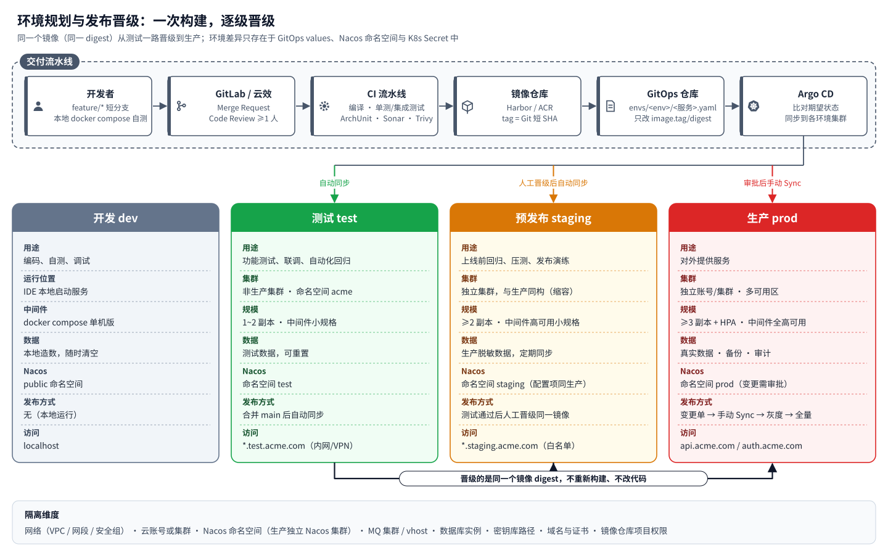
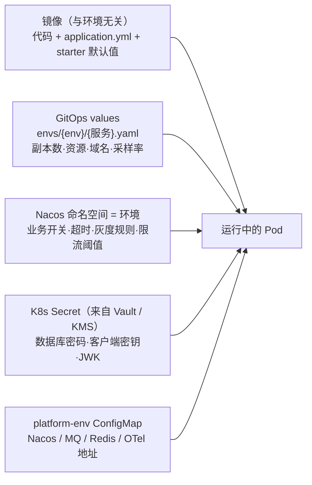
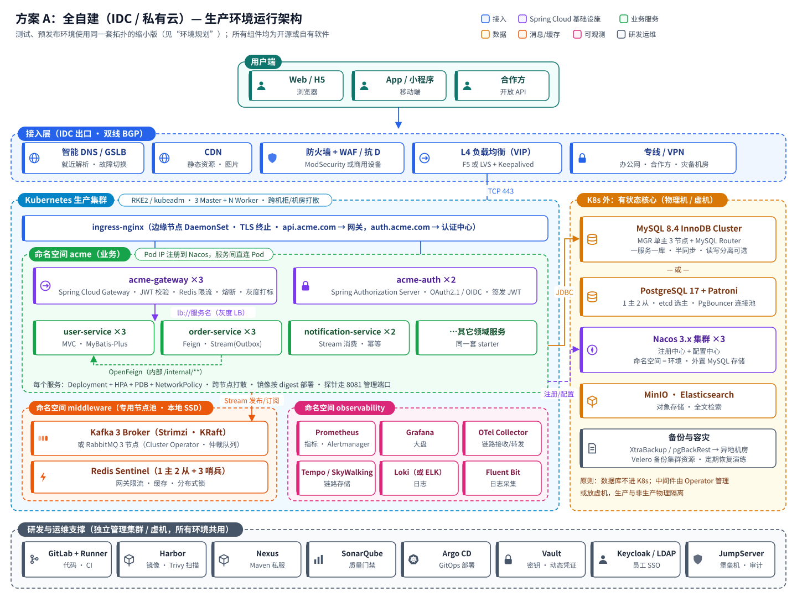
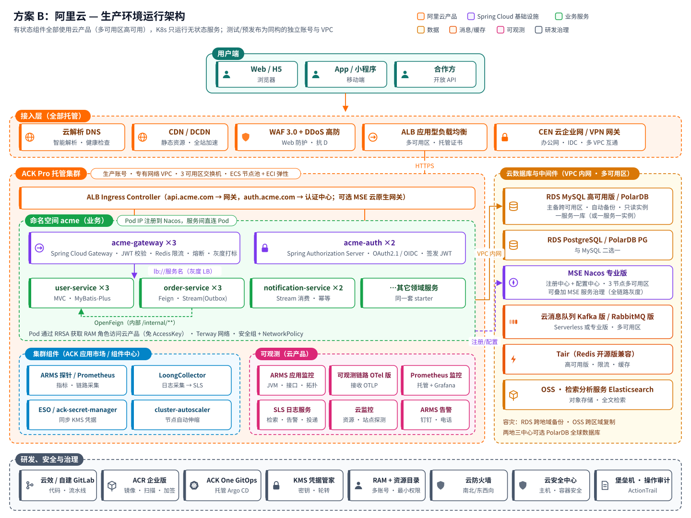
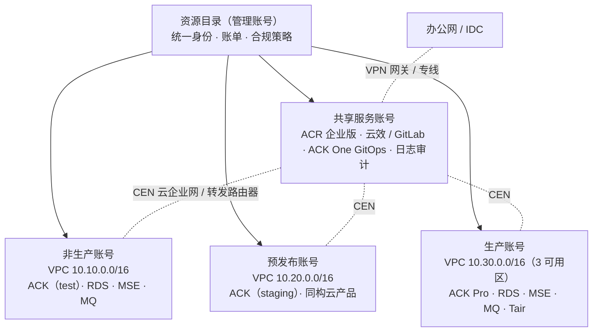
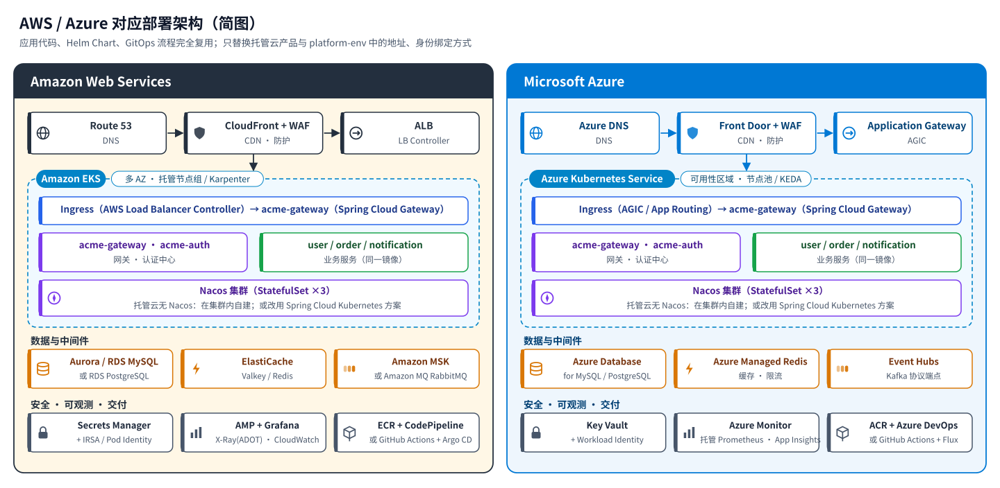
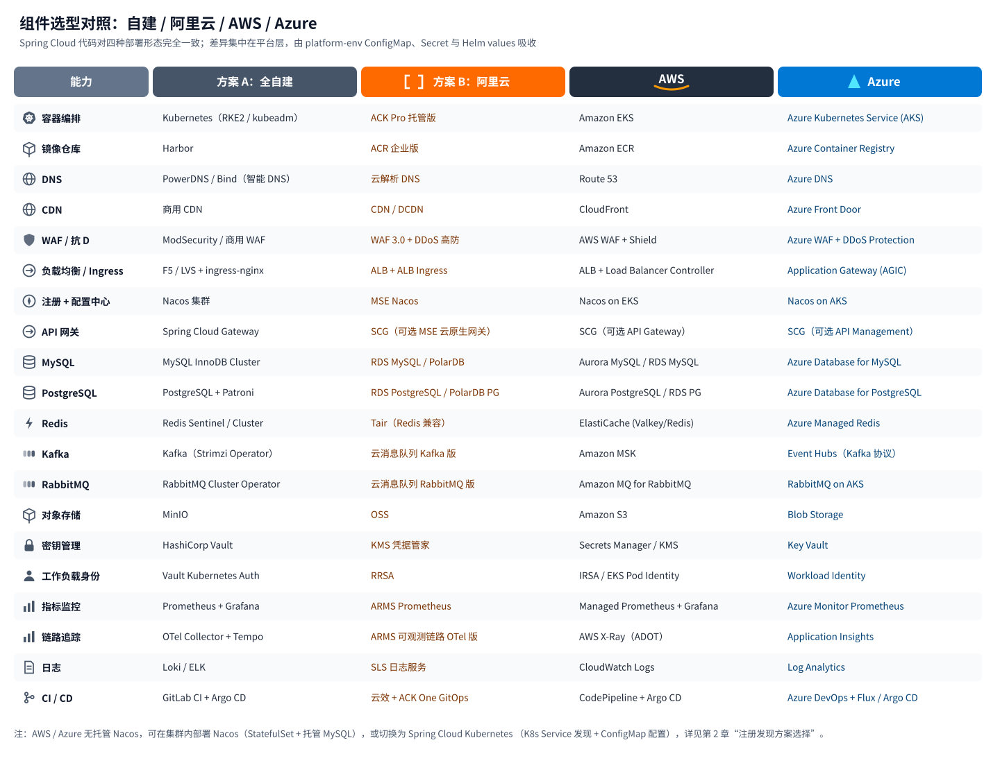
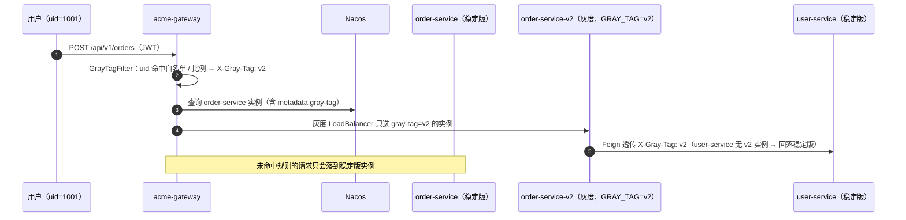

# 第 1 章 运行架构：环境规划与部署方案

> 本章回答“系统跑在哪里、怎么跑”：测试 / 预发布 / 生产三套环境如何划分与隔离，以及两种落地方案——**方案 A 全自建**、**方案 B 阿里云**，并给出 AWS、Azure 的对应关系。
> 应用层（Spring Cloud 代码、镜像、Helm Chart、GitOps 流程）在所有方案中**完全一致**，差异只在平台层。

## 1.1 总体设计原则

| 原则 | 含义 | 落地方式 |
| --- | --- | --- |
| 一次构建，处处部署 | 同一个镜像（同一 digest）从测试晋级到生产，环境差异不进镜像 | 配置分三处：GitOps values（规模）、Nacos 命名空间（业务配置）、K8s Secret（凭据） |
| 无状态计算进 K8s，有状态数据靠专业设施 | 应用 Pod 可随时重建；数据库等有状态组件需要专门的高可用与备份手段 | 自建：数据库放 K8s 外物理机/虚机；阿里云：RDS / PolarDB / Tair / 云消息队列 |
| 环境同构 | 预发布与生产拓扑、组件版本、配置项一致，只是规模更小 | 同一套 Helm Chart + 环境 values；Nacos 配置项逐项对齐 |
| 默认安全 | 最小权限、密钥不落地、网络默认拒绝 | NetworkPolicy、非 root 容器、External Secrets、RRSA / Vault |
| 可观测先行 | 上线即有指标、链路、日志、告警 | 所有服务通过 `acme-starter-base` 统一接入 Micrometer + OpenTelemetry |
| 声明式与可追溯 | 环境状态以 Git 为准，变更可审计、可回滚 | GitOps（Argo CD），生产手动 Sync + 审批 |

## 1.2 环境规划

### 1.2.1 四类环境的定位

| 项目 | 开发 dev | 测试 test | 预发布 staging | 生产 prod |
| --- | --- | --- | --- | --- |
| 目的 | 编码自测 | 功能测试、联调、自动化回归 | 上线前最终验证：回归、压测、发布演练、数据迁移演练 | 对外服务 |
| 运行位置 | 开发者本机 | 非生产 K8s 集群（命名空间 `acme`） | **独立集群**，与生产同构 | 独立集群 / 独立云账号，多可用区 |
| 规模 | 单实例 | 1~2 副本；中间件单节点或最小规格 | ≥2 副本；中间件高可用版小规格 | ≥3 副本 + HPA；中间件全高可用 |
| 数据 | 本地造数 | 测试数据，可随时重置 | 生产脱敏数据（定期同步） | 真实数据，备份 + 审计 |
| Nacos 命名空间 | `public` | `test` | `staging` | `prod`（生产使用独立 Nacos 集群） |
| 部署方式 | 无 | 合入 `main` 后 Argo CD 自动同步 | 测试通过后人工晋级同一镜像 | 变更单审批 → Argo CD 手动 Sync → 灰度 → 全量 |
| 域名 | `localhost` | `*.test.acme.com`（内网 / VPN） | `*.staging.acme.com`（IP 白名单） | `api.acme.com`、`auth.acme.com` |
| 谁能操作 | 开发者 | 开发、测试 | 测试、运维、发布负责人 | 仅运维 / 发布负责人（堡垒机 + 审批） |

> **为什么预发布要独立集群？** 预发布的价值在于“和生产一样”。如果与测试共用集群，节点规格、网络策略、中间件拓扑都会和生产不同，压测和发布演练的结论就不可信。成本敏感时可以缩小节点规模，但不要改变拓扑。

### 1.2.2 环境隔离

| 维度 | 测试 | 预发布 | 生产 |
| --- | --- | --- | --- |
| 网络 | 非生产网段 / VPC | 独立网段 / VPC | 独立网段 / VPC，与非生产默认不通 |
| 集群 / 账号 | 非生产集群 | 预发布集群（自建可与测试共用管理面） | 生产集群；云上使用独立账号（资源目录） |
| 注册配置中心 | Nacos（非生产集群）命名空间 `test` | Nacos 命名空间 `staging` | **独立 Nacos 集群**，命名空间 `prod` |
| 数据库 | 共享实例，一服务一库 | 独立实例 | 独立实例（高可用） |
| 消息 | 共享集群，独立 vhost / topic 前缀可选 | 独立集群 | 独立集群 |
| 密钥 | `kv/test/**` | `kv/staging/**` | `kv/prod/**`，仅生产集群身份可读 |
| 镜像仓库 | 同一仓库 | 同一仓库 | 同一仓库（按 digest 拉取，只读权限） |

### 1.2.3 环境差异放在哪里

- **镜像**里只有与环境无关的默认值，例如超时、连接池、日志格式开关；
- **GitOps values** 描述“部署形态”：副本数、资源、HPA、Ingress 域名、采样率；
- **Nacos** 描述“业务行为”，可以热更新；
- **Secret** 只放凭据，从 Vault / 阿里云 KMS 凭据管家同步，永不进 Git 和 Nacos；
- **platform-env** 是平台团队维护的“地址簿”，每个集群一份（见 `acme-cloud/deploy/k8s/platform/`）。

## 1.3 方案 A：全自建（IDC / 私有云）

### 1.3.1 分层说明

| 层 | 组件 | 选型 | 部署方式 | 生产规模（示例） |
| --- | --- | --- | --- | --- |
| 接入 | DNS / GSLB | PowerDNS 或商用智能 DNS | 双机房 | 2 套 |
| 接入 | WAF / 抗 D | ModSecurity（OWASP CRS）或商用 WAF 设备 + 运营商清洗 | 旁路或串联 | 主备 |
| 接入 | L4 负载均衡 | F5，或 LVS（DR 模式）+ Keepalived | 物理机 | 主备 |
| 接入 | Ingress | ingress-nginx | 边缘节点 DaemonSet，hostNetwork | 3 节点 |
| 计算 | Kubernetes | RKE2 或 kubeadm（1.32+），containerd，Calico / Cilium | 物理机或虚拟机 | 3 Master + 6~N Worker |
| Spring Cloud | 网关 / 认证 | Spring Cloud Gateway / Spring Authorization Server | K8s Deployment | 3 / 2 副本 |
| Spring Cloud | 注册 + 配置 | Nacos 3.x 集群 | K8s 外虚机（或独立命名空间 StatefulSet），外置 MySQL | 3 节点 |
| 数据 | 关系库 | MySQL 8.4 InnoDB Cluster（MGR 单主 + MySQL Router）**或** PostgreSQL 17 + Patroni + PgBouncer | 物理机 / 虚机，本地 NVMe | 1 主 2 从 |
| 消息 | MQ | Kafka 4.x（Strimzi，KRaft）**或** RabbitMQ 4.x（Cluster Operator，仲裁队列） | K8s 专用节点池，本地 SSD | 3 节点 |
| 缓存 | Redis | Redis 8 Sentinel（或 Cluster） | K8s 专用节点池或虚机 | 1 主 2 从 + 3 哨兵 |
| 存储 | 对象 / 块存储 | MinIO；Ceph RBD 或 Longhorn（仅给中间件用） | 独立节点 | 4 节点纠删码 |
| 可观测 | 指标 / 告警 | Prometheus（kube-prometheus-stack）+ Alertmanager + Grafana | K8s | 2 副本 + 远端存储（Thanos / VictoriaMetrics） |
| 可观测 | 链路 | OpenTelemetry Collector → Grafana Tempo（或 SkyWalking） | K8s | — |
| 可观测 | 日志 | Fluent Bit → Loki（或 Elasticsearch） | K8s | — |
| 研发 | 代码 / CI | GitLab + Runner（K8s Executor） | 管理集群 | — |
| 研发 | 制品 | Harbor（镜像 + Trivy）、Nexus（Maven） | 管理集群 | — |
| 交付 | GitOps | Argo CD（管理集群，纳管 test / staging / prod） | 管理集群 | HA 模式 |
| 安全 | 密钥 | HashiCorp Vault + External Secrets Operator | 管理集群 | 3 节点 Raft |
| 安全 | 运维入口 | JumpServer 堡垒机、Keycloak / LDAP（员工 SSO） | 管理集群 | — |

### 1.3.2 关键设计点

1. **数据库不进 K8s。** 数据库的高可用、备份、扩容、内核调优都需要专门的手段；在 IDC 里放在物理机上更可控。消息与缓存可以由 Operator（Strimzi、RabbitMQ Cluster Operator）管理，但必须放在**专用节点池**（污点隔离、本地 SSD），避免与业务 Pod 争抢资源。
2. **服务直连 Pod IP。** 服务注册到 Nacos 的是 Pod IP，服务间调用不经过 kube-proxy；网关通过 `lb://服务名` 解析。因此 Pod 网络需与 Nacos 所在网络互通（Calico BGP 或 Overlay 均可，需放通 Nacos 8848/9848 端口）。
3. **三个集群 + 一个管理集群。** 测试、预发布、生产各一个业务集群；GitLab、Harbor、Argo CD、Vault 放在管理集群（或虚机），所有环境共用。生产集群的 API Server 只对管理集群和堡垒机开放。
4. **双机房（可选）。** 生产 K8s Worker 跨两个机房（同城，<2ms），MySQL MGR 三节点分布在两机房 + 仲裁机房；Kafka 设置 `broker.rack` 实现跨机房副本。
5. **备份。** MySQL 用 XtraBackup 全量 + binlog 增量（RPO ≤ 5 分钟），PostgreSQL 用 pgBackRest + WAL 归档；K8s 资源用 Velero；全部备份异地存放并**每季度做恢复演练**。

### 1.3.3 三套环境的资源规划（示例）

| 资源 | 测试 | 预发布 | 生产 |
| --- | --- | --- | --- |
| K8s 节点 | 与开发共用，3 × 16C64G | 3 Master + 3 × 16C64G | 3 Master + 6 × 32C128G（按 HPA 峰值预留 30%） |
| MySQL / PostgreSQL | 单实例 8C32G | 1 主 1 从 8C32G | 1 主 2 从 32C128G，NVMe |
| Kafka / RabbitMQ | 单节点 | 3 节点 4C16G | 3 节点 16C64G |
| Redis | 单节点 | Sentinel 小规格 | Sentinel 3 × 8C32G |
| Nacos | 单机 + 内嵌存储 | 3 节点 | 3 节点（独立集群） |

## 1.4 方案 B：阿里云

### 1.4.1 产品清单与各环境规格建议

| 能力 | 阿里云产品 | 生产 | 预发布 | 测试 |
| --- | --- | --- | --- | --- |
| 容器 | **ACK Pro 托管版** | 3 可用区节点池，ECS 计算型 + ECI 弹性 | 同构，2 可用区 | ACK 基础版或与开发共用；可用抢占式实例 |
| 入口 | **ALB** + ALB Ingress Controller | 多可用区、WAF 联动 | 同构 | 共享 ALB |
| 防护 | **WAF 3.0**、DDoS 高防 | 开启 | 开启（规则同生产） | 可不开 |
| 注册 + 配置 | **MSE Nacos 专业版** | 3 节点 | 专业版小规格 | 开发版（或与测试共享） |
| 关系库 | **RDS MySQL 高可用版 / PolarDB MySQL**，或 **RDS PostgreSQL / PolarDB PG** | 独享规格、多可用区、只读实例 | 通用规格高可用 | 基础版 |
| 缓存 | **Tair（Redis 开源版兼容）** | 高可用版 / 集群版 | 高可用版小规格 | 标准版 |
| 消息 | **云消息队列 Kafka 版 / RabbitMQ 版** | 专业版，多可用区 | 标准版 | Serverless 按量 |
| 对象存储 | OSS | 同城冗余存储 | 本地冗余 | 本地冗余 |
| 镜像 | **ACR 企业版** | 全局共用，镜像扫描 + 加签 | 共用 | 共用 |
| 交付 | ACK One GitOps（托管 Argo CD）或自建 Argo CD；云效 Codeup / Flow 或自建 GitLab | 共用 | 共用 | 共用 |
| 密钥 | **KMS 凭据管家** + External Secrets（RRSA 免 AK） | 独立凭据 | 独立凭据 | 独立凭据 |
| 可观测 | **ARMS** 应用监控 / 可观测链路 OpenTelemetry 版、**Prometheus 监控**、**SLS** 日志服务 | 全量 | 全量 | 采样或按量 |
| 安全治理 | 资源目录多账号、RAM、云防火墙、云安全中心、运维安全中心（堡垒机）、ActionTrail | 开启 | 开启 | 基础 |

### 1.4.2 多账号与网络布局

### 1.4.3 关键设计点

1. **有状态全部托管。** 数据库、缓存、消息、Nacos 使用云产品，ACK 只运行无状态服务——运维重心从“维护中间件”转到“用好中间件”。
2. **入口二选一。** 默认 `ALB → ALB Ingress → acme-gateway（Spring Cloud Gateway）`，网关逻辑在代码里，可测试、可灰度；如果希望把鉴权、限流也交给云产品，可用 **MSE 云原生网关** 替换 ALB Ingress（此时 Spring Cloud Gateway 可保留做业务路由，或下沉其职责）。
3. **RRSA 免密钥。** Pod 通过 RRSA（RAM Roles for Service Accounts）获取临时凭证访问 KMS、OSS 等，代码与配置中不出现 AccessKey。Helm values 的 `serviceAccount.annotations` 用于绑定角色。
4. **可观测接入零改造。** 服务通过 OTLP 上报链路，只需把 `OTEL_EXPORTER_OTLP_TRACES_ENDPOINT` 指向 ARMS 接入点；指标仍是 `/actuator/prometheus`，由 ARMS Prometheus 采集；日志输出 JSON 到 stdout，由 LoongCollector 采集到 SLS。
5. **成本优化。** 测试环境节点池使用抢占式实例 + ECI 弹性；预发布非工作时间缩容（定时 HPA 或 CronHPA）；生产预留实例 / 节省计划覆盖基线容量。
6. **容灾。** 生产三可用区部署；RDS 跨地域备份、OSS 跨区域复制；需要两地三中心时采用 PolarDB 全球数据库 + 异地 ACK 集群冷备 / 温备。

## 1.5 AWS / Azure 对应方案

迁移到 AWS / Azure 时需要关注的差异：

| 差异点 | 处理方式 |
| --- | --- |
| 无托管 Nacos | 在 EKS / AKS 内用 StatefulSet 部署 Nacos 集群（存储用托管 MySQL）；或改用 **Spring Cloud Kubernetes**（K8s Service 发现 + ConfigMap 配置，见 2.3.3） |
| RabbitMQ（Azure） | Azure 无托管 RabbitMQ：在 AKS 用 RabbitMQ Cluster Operator 部署，或优先选 Kafka（Event Hubs 提供 Kafka 协议端点） |
| 身份 | AWS 用 IRSA / EKS Pod Identity，Azure 用 Workload Identity，均通过 `serviceAccount.annotations` 配置 |
| 链路 | AWS 用 ADOT（OpenTelemetry 发行版）+ X-Ray，Azure 用 Application Insights（支持 OTLP），只改 OTLP 地址 |

## 1.6 方案对比与选型建议

| 维度 | 方案 A 全自建 | 方案 B 阿里云 |
| --- | --- | --- |
| 初始投入 | 高：硬件、机房、网络、各组件高可用搭建 | 低：按需开通 |
| 长期成本 | 规模大且稳定时更低 | 弹性好；规模很大时需用预留实例控制成本 |
| 运维人力 | 需要 DBA、中间件、K8s 专职团队 | 平台团队 2~3 人即可支撑 |
| 弹性 | 受限于机房容量 | 分钟级扩容（ECI / 节点池自动伸缩） |
| 高可用 / 容灾 | 依赖自建能力与演练 | 多可用区开箱即用，跨地域方案成熟 |
| 合规 / 数据主权 | 完全自主可控 | 满足等保、金融云等，但依赖云厂商 |
| 技术锁定 | 无 | 低（只使用开源兼容产品：Nacos、Kafka、RabbitMQ、Redis、MySQL/PG、K8s） |

**建议**：业务早期或团队规模有限时优先**方案 B**；对数据主权、长期成本有硬性要求时选**方案 A**；也可以**混合**——测试 / 预发布上云快速迭代，生产自建；或核心数据自建、弹性业务上云（通过专线 + Nacos 多集群同步）。由于代码与交付流程完全一致，方案之间可以平滑迁移。

## 1.7 高可用与容灾

| 层级 | 措施 |
| --- | --- |
| 应用 | ≥3 副本，`topologySpreadConstraints` 跨可用区 / 节点打散；PDB `maxUnavailable: 1`；滚动更新 `maxUnavailable: 0` |
| 实例下线 | `preStop` 等待 10s（Nacos / Ingress 摘流量）→ SIGTERM → Spring 优雅停机 30s → 进程退出，`terminationGracePeriodSeconds: 60` |
| 依赖故障 | Feign / 网关熔断 + 超时；消息异步解耦；Outbox 保证事件不丢 |
| 数据 | 主从 / MGR 自动切换；RPO ≤ 5 分钟（自建）/ ≤ 1 分钟（RDS）；每季度恢复演练 |
| 注册中心 | Nacos 集群 3 节点；客户端本地缓存实例列表，Nacos 短暂不可用不影响已建立的调用 |
| 机房 / 可用区 | 生产跨 3 可用区（或同城双机房 + 仲裁）；跨地域为冷备 / 温备 |

建议的初始目标：核心链路可用性 99.95%，RTO ≤ 30 分钟，RPO ≤ 5 分钟。

## 1.8 发布流程

### 1.8.1 从提交到生产

```mermaid
flowchart LR
    A["feature/* 分支"] -->|Merge Request<br/>Code Review + CI 通过| B["main"]
    B --> C["CI：mvn verify<br/>ArchUnit · Sonar"]
    C --> D["构建镜像 · Trivy 扫描<br/>推送 tag = Git SHA"]
    D --> E["更新 envs/test/*.yaml"]
    E -->|Argo CD 自动同步| T["测试环境"]
    T -->|自动化回归通过<br/>人工晋级| S["envs/staging/*.yaml"]
    S -->|自动同步| ST["预发布环境<br/>回归 · 压测 · 演练"]
    ST -->|变更单审批| P["envs/prod/*.yaml<br/>写入 digest"]
    P -->|发布负责人手动 Sync| G["生产灰度"]
    G -->|指标正常| F["生产全量"]
```

### 1.8.2 全链路灰度

- 灰度 Release：在 `envs/prod/` 下新增 `order-service-gray.yaml`（`grayTag: v2`），与稳定版共享 Service，只多一组 Pod；
- 灰度规则在 Nacos 的 `acme-gateway.yaml` 中（白名单 uid + 百分比），修改即时生效；
- 验证通过后，把稳定版的 `image` 改为新版本并删除灰度文件；出现问题则直接删除灰度文件，**无需回滚稳定版**。

### 1.8.3 回滚

- **应用回滚**：在 GitOps 仓库 `git revert` 对应的版本提交（或 Argo CD History 回滚到上一个 Revision），镜像仍在仓库中，秒级完成；
- **配置回滚**：Nacos 历史版本一键回滚；
- **数据库**：Flyway 只做向前兼容的变更（先加列、后删列，跨两个版本完成），因此应用回滚不需要回滚数据库。
