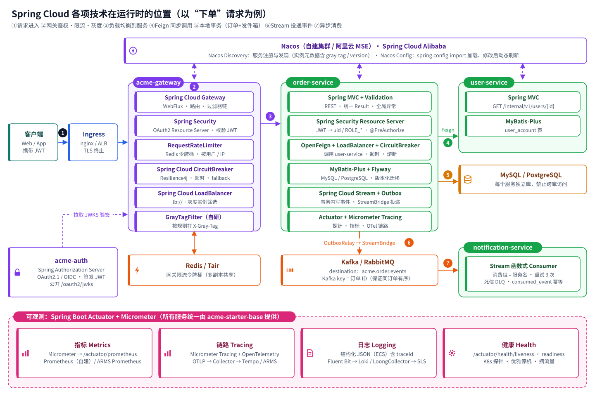
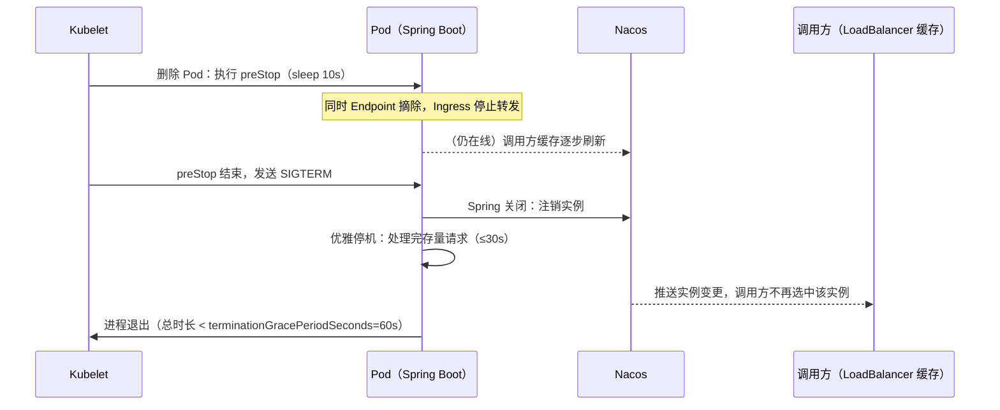
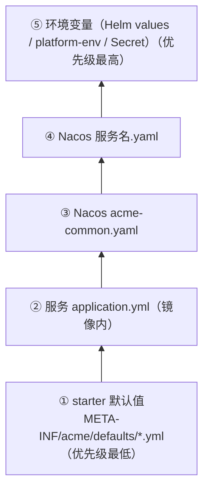
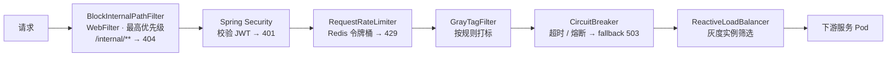
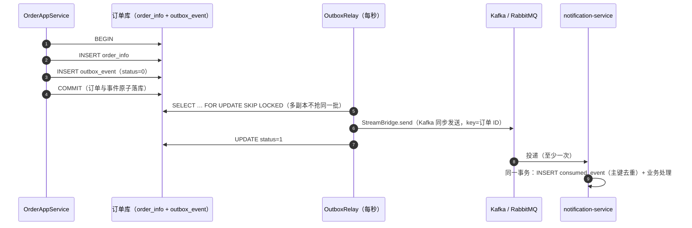
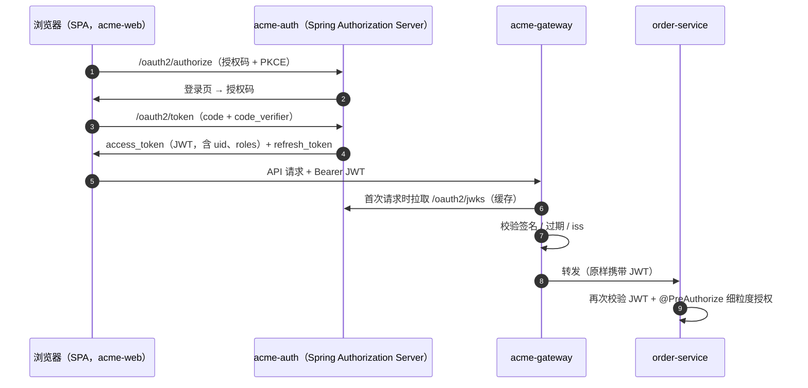
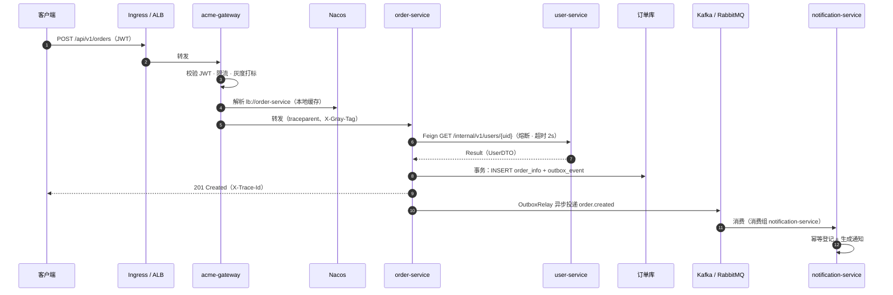

# 第 2 章 Spring Cloud 技术在整套环境中的体现

> 本章逐项说明 Spring Cloud 体系中每一项技术**用在哪里、为什么这样选、在不同环境中有何差异**，并给出初始工程 `acme-cloud/` 中对应的代码位置。

## 2.1 版本基线

| 组件 | 版本 | 说明 |
| --- | --- | --- |
| JDK | 21（LTS） | 虚拟线程可按需开启：`spring.threads.virtual.enabled=true` |
| Spring Boot | **4.0.9** | Spring Framework 7、Jakarta EE 11、Jackson 3、模块化 starter |
| Spring Cloud | **2025.1.4**（Oakwood） | 与 Boot 4.0.x 配套 |
| Spring Cloud Alibaba | **2025.1.0.0** | Nacos 客户端 3.1.x，与 Spring Cloud 2025.1 配套 |
| MyBatis-Plus | 3.5.17（`mybatis-plus-spring-boot4-starter`） | |
| springdoc-openapi | 3.0.3 | |
| Nacos Server | 3.1.x | 自建集群或阿里云 MSE |

**升级策略**：Spring Boot / Spring Cloud / Spring Cloud Alibaba 是一个**版本矩阵**，必须成套升级；版本只在根 `pom.xml` 中声明一次，业务模块禁止写三方依赖版本号。每个季度评估一次补丁版本，跟随 Spring Boot 的 OSS 支持周期规划大版本升级。

## 2.2 全景：一次请求经过哪些 Spring Cloud 组件



| 能力 | 选用技术 | 在工程中的位置 | 方案 A 自建 | 方案 B 阿里云 |
| --- | --- | --- | --- | --- |
| 服务注册与发现 | Spring Cloud Alibaba **Nacos Discovery** | `acme-starter-base` | Nacos 3 节点集群 | MSE Nacos |
| 配置中心 | Spring Cloud Alibaba **Nacos Config**（`spring.config.import`） | `acme-starter-base`、各服务 `application.yml` | 同上 | 同上 |
| API 网关 | **Spring Cloud Gateway**（Server WebFlux） | `acme-gateway` | ingress-nginx → 网关 | ALB Ingress → 网关（可选 MSE 云原生网关） |
| 负载均衡 | **Spring Cloud LoadBalancer** + 自研灰度筛选 | `acme-starter-base/loadbalancer` | — | 可叠加 MSE 服务治理 |
| 服务调用 | **Spring Cloud OpenFeign** | `acme-starter-feign`、`xxx-api` | — | — |
| 熔断 / 超时 | **Spring Cloud CircuitBreaker**（Resilience4j） | `acme-starter-feign`、`acme-gateway` | — | 可选 Sentinel / MSE 服务治理 |
| 消息驱动 | **Spring Cloud Stream**（Kafka / RabbitMQ Binder） | `acme-starter-mq` | Kafka（Strimzi）/ RabbitMQ | 云消息队列 Kafka 版 / RabbitMQ 版 |
| 认证授权 | **Spring Authorization Server** + Spring Security Resource Server | `acme-auth`、`acme-starter-security` | 自建 | 自建（或阿里云 IDaaS） |
| 链路追踪 | **Micrometer Tracing** + OpenTelemetry（OTLP） | `acme-starter-base` | OTel Collector → Tempo | ARMS 可观测链路 |
| 指标 | **Micrometer** + Actuator Prometheus 端点 | `acme-starter-base` | Prometheus | ARMS Prometheus |
| 健康检查 | **Spring Boot Actuator** 探针 | `acme-starter-base` | K8s 探针 | K8s 探针 |
| 数据访问 | MyBatis-Plus + Flyway | `acme-starter-mybatis` | MySQL / PostgreSQL | RDS / PolarDB |

> 不再使用的组件：Eureka、Ribbon、Hystrix、Zuul（均已停止维护）；Spring Cloud Sleuth（被 Micrometer Tracing 取代）；Spring Cloud Config Server + Bus（被 Nacos Config 取代，见 2.4）。

## 2.3 服务注册与发现：Nacos Discovery

### 2.3.1 为什么在 K8s 上仍然使用 Nacos

K8s 自带 Service + DNS 也能做服务发现。两种方案的对比：

| 维度 | Nacos Discovery（本方案默认） | K8s Service / Spring Cloud Kubernetes |
| --- | --- | --- |
| 调用路径 | 客户端负载均衡，直连 Pod IP | 经 kube-proxy（iptables / IPVS）或 Spring Cloud Kubernetes 的 DiscoveryClient |
| 实例元数据 | 支持（`gray-tag`、`version`、`zone`），是**全链路灰度**的基础 | 需要读取 Pod label，依赖 RBAC 权限 |
| 跨集群 / 混合部署 | 天然支持（K8s 内外、多集群都注册到同一 Nacos） | 只能看到本集群 |
| 配置中心 | 同一套组件提供，支持灰度发布配置、历史回滚、权限 | ConfigMap，需要自建审批与审计 |
| 阿里云 | MSE Nacos 托管，并可叠加 MSE 服务治理 | — |
| 额外运维 | 需维护 Nacos 集群（云上托管则无） | 无 |

**结论**：中大型系统需要灰度、跨集群与统一配置治理，默认选 **Nacos**；如果部署在 AWS / Azure 又不想自建 Nacos，可切换为 **Spring Cloud Kubernetes**（替换 `acme-starter-base` 中的两个 Nacos 依赖为 `spring-cloud-starter-kubernetes-fabric8-all`，业务代码无需改动——业务代码只依赖 `lb://服务名` 与 `@FeignClient(name = ...)`）。

### 2.3.2 配置与约定

平台默认配置（`acme-starter-base/src/main/resources/META-INF/acme/defaults/00-base.yml`）：

```yaml
spring:
  cloud:
    nacos:
      server-addr: ${NACOS_SERVER_ADDR:127.0.0.1:8848}
      discovery:
        namespace: ${NACOS_NAMESPACE:}      # 命名空间 = 环境（test / staging / prod）
        metadata:
          gray-tag: ${GRAY_TAG:}            # 灰度标签，Deployment 环境变量注入
          version: ${APP_VERSION:dev}       # 镜像 tag
```

| 约定 | 说明 |
| --- | --- |
| 服务名 | `spring.application.name`，小写中划线，如 `order-service`；与 K8s Deployment / Service 同名 |
| 命名空间 | 环境名；生产使用独立 Nacos 集群，命名空间仍为 `prod`，防止误连 |
| 分组 | 默认 `DEFAULT_GROUP`；多个产品线共用 Nacos 时按产品线分组 |
| 注册 IP | Pod IP（默认行为），K8s 中不要注册 Node IP 或 NodePort |
| 临时实例 | 默认临时实例（心跳维持），Pod 被删除后自动摘除 |

### 2.3.3 K8s 中的优雅上下线



上线时，readinessProbe（`/actuator/health/readiness`）通过前 Pod 不接收 Ingress 流量；Nacos 注册发生在 Web 服务器启动后，因此调用方不会在应用未就绪时选中它。

## 2.4 配置中心：Nacos Config

### 2.4.1 加载方式

Spring Boot 4 中通过 `spring.config.import` 声明（不再使用 bootstrap.yml）：

```yaml
spring:
  application:
    name: order-service
  config:
    import:
      - optional:nacos:acme-common.yaml            # 所有服务共享
      - optional:nacos:${spring.application.name}.yaml   # 本服务
```

### 2.4.2 配置分层与优先级



| 配置类型 | 放在哪里 | 示例 |
| --- | --- | --- |
| 平台规范默认值 | starter 的 `defaults/*.yml` | 探针、优雅停机、Feign 超时、熔断阈值、日志格式 |
| 服务固定配置 | 服务 `application.yml` | 服务名、Stream binding、端口默认值 |
| 可动态调整的业务配置 | Nacos | 业务开关、灰度规则、限流阈值、下游超时 |
| 部署形态 | GitOps values → 环境变量 | 副本数、资源、采样率、是否开启 API 文档 |
| 凭据 | Vault / KMS → K8s Secret → 环境变量 | 数据库密码、客户端密钥、JWK 私钥 |
| 基础设施地址 | platform-env ConfigMap | Nacos / Kafka / Redis / OTel 地址 |

> 平台默认值由 `AcmeDefaultsEnvironmentPostProcessor` 以**最低优先级**加载，因此“规范默认正确、服务可以覆盖”。业务服务的 `application.yml` 通常只有十几行。

### 2.4.3 动态刷新

- `@ConfigurationProperties` 的 **JavaBean 风格**类在 Nacos 配置变更后会自动重新绑定；**record / 构造器绑定**的类不会刷新（例如 `OutboxProperties`，修改需滚动重启）；
- 需要刷新的 `@Value` 字段所在 Bean 加 `@RefreshScope`；
- 网关路由（`spring.cloud.gateway.server.webflux.routes`）放在 Nacos 的 `acme-gateway.yaml` 中时，变更后 Gateway 自动刷新路由；
- 生产配置变更走审批：Nacos 开启鉴权，生产命名空间只读给研发，变更由运维在变更单中执行，并利用 Nacos **配置灰度（Beta 发布）**先推给部分实例。

## 2.5 API 网关：Spring Cloud Gateway

代码：`acme-cloud/acme-gateway`

### 2.5.1 职责边界

| 网关负责 | 网关不负责 |
| --- | --- |
| 路由（`lb://服务名`）、统一入口 | 业务逻辑、数据聚合（放到 BFF 或领域服务） |
| JWT 校验（签名、过期、iss） | 细粒度授权（由服务 `@PreAuthorize` 完成） |
| 限流（Redis 令牌桶，按用户 / IP） | 业务级配额（由业务服务实现） |
| 熔断降级、超时、CORS | 请求体改写等重逻辑 |
| 灰度打标（`X-Gray-Tag`） | TLS 终止（由 Ingress / ALB 完成） |
| 屏蔽 `/internal/**` | |

### 2.5.2 过滤器链



> 注意：`/internal/**` 的拦截必须实现为 `WebFilter` 并排在 Spring Security 之前，否则未登录请求先得到 401，间接暴露了内部接口的存在（初始工程中有测试覆盖）。

### 2.5.3 路由配置示例

```yaml
spring:
  cloud:
    gateway:
      server:
        webflux:
          discovery.locator.enabled: false     # 只暴露显式声明的路由
          default-filters:
            - name: RequestRateLimiter
              args:
                key-resolver: "#{@principalOrIpKeyResolver}"
                redis-rate-limiter.replenishRate: 20
                redis-rate-limiter.burstCapacity: 40
          routes:
            - id: order-service
              uri: lb://order-service
              predicates: [ "Path=/api/v1/orders/**" ]
              filters:
                - name: CircuitBreaker
                  args: { name: order-service, fallbackUri: "forward:/fallback/order-service" }
```

### 2.5.4 与 Ingress / 云网关的分工

- **自建**：ingress-nginx 只做 TLS 终止与按域名转发（`api.acme.com → acme-gateway`、`auth.acme.com → acme-auth`）；
- **阿里云**：ALB 承担 TLS 与 WAF 联动；若选择 **MSE 云原生网关**，可把 JWT 校验、限流迁移过去，Spring Cloud Gateway 只保留业务路由与灰度逻辑，或整体下线；
- 不要在 Ingress 与 Gateway 两层都做业务路由，避免规则分散。

## 2.6 服务调用：OpenFeign + LoadBalancer

代码：`acme-starter-feign`、`user-api`、`order-server/infrastructure/remote`

### 2.6.1 契约即模块

服务提供方发布 `xxx-api` 模块（Feign 接口 + DTO），调用方依赖它：

```java
@FeignClient(name = UserClient.SERVICE_NAME, contextId = "userClient", path = "/internal/v1/users")
public interface UserClient {
    String SERVICE_NAME = "user-service";

    @GetMapping("/{id}")
    Result<UserDTO> getUser(@PathVariable("id") Long id);
}
```

调用方显式启用：`@EnableFeignClients(clients = UserClient.class)`，并在 `infrastructure.remote` 中做一层**防腐适配**（`BuyerGatewayImpl`），领域层只看到 `BuyerGateway` 接口。

### 2.6.2 平台提供的能力（starter 自动配置）

| 能力 | 实现 |
| --- | --- |
| 连接池 HTTP 客户端 | `feign-hc5`（Apache HttpClient 5） |
| 超时 | 默认连接 1s、读取 3s；按 `contextId` 单独调整 |
| 熔断 | 每个 Feign 方法自动包装 Spring Cloud CircuitBreaker（Resilience4j） |
| 请求头透传 | `HeaderRelayRequestInterceptor`：`Authorization`、`X-Gray-Tag`、`Accept-Language` |
| 链路传播 | `feign-micrometer`，自动注入 `traceparent` |
| 错误解码 | `AcmeFeignErrorDecoder`：下游 4xx + Result → `BizException`（保留错误码）；5xx / 网络错误 → `RemoteServiceException` |
| 灰度负载均衡 | `GrayServiceInstanceListSupplier`：请求带 `X-Gray-Tag` 时优先选同标签实例，否则只选稳定实例 |

### 2.6.3 演进方向

Spring Cloud OpenFeign 目前处于功能冻结（feature complete）状态，仍会维护与发布。Spring Framework 7 提供了基于 `@HttpExchange` 的 HTTP Service Client，Spring Cloud 也在为其补齐负载均衡与熔断集成。建议：**存量与本期继续使用 OpenFeign**，`xxx-api` 中的接口只使用 Spring MVC 注解与 DTO，将来可以低成本迁移为 `@HttpExchange` 接口。

## 2.7 容错：Spring Cloud CircuitBreaker（Resilience4j）

| 位置 | 作用 | 关键配置 |
| --- | --- | --- |
| 网关路由 | 下游整体不可用时快速失败，返回 `C0503` | `resilience4j.timelimiter.configs.default.timeout-duration: 8s` |
| Feign 调用 | 单个下游异常时保护调用方线程与连接 | `failure-rate-threshold: 50`、`slow-call-duration-threshold: 2s`、`wait-duration-in-open-state: 10s` |

两条重要约定（`20-feign.yml`）：

1. **熔断器忽略 `BizException`**：下游返回的“用户不存在”等 4xx 是正常业务结果，不能把熔断器打开；
2. **Feign 场景关闭 TimeLimiter**（`spring.cloud.circuitbreaker.resilience4j.disable-time-limiter: true`）：超时交给 HTTP 客户端，调用保持在当前线程，`RequestContextHolder` 中的请求头才能被透传。

**重试**：只对幂等的 GET 请求开启（LoadBalancer 的 `spring.cloud.loadbalancer.retry`），写请求不自动重试，由业务幂等键 + 客户端重试保证。

**替代方案**：阿里云上可使用 **Sentinel**（Spring Cloud Alibaba Sentinel）或 **MSE 服务治理**，获得控制台化的流控、热点参数限流与全链路灰度；与 Resilience4j 二选一，不要叠加。

## 2.8 消息驱动：Spring Cloud Stream

代码：`acme-starter-mq`、`order-server`（生产者）、`notification-server`（消费者）

### 2.8.1 Kafka 还是 RabbitMQ

| 场景 | 推荐 |
| --- | --- |
| 领域事件广播、多订阅方、需要回放 / 数据同步 / 审计流水 | **Kafka** |
| 高吞吐、按 key 有序 | **Kafka** |
| 任务队列、复杂路由（topic / headers 交换机）、延迟消息、每条消息独立确认 | **RabbitMQ** |
| 团队已有某一种的运维经验 | 选已有的那种 |

初始工程**同时支持两者**，代码完全相同：服务 pom 中 `kafka` profile 默认激活，`mvn package -Prabbit` 即切换为 RabbitMQ Binder；各自的专有配置写在 `spring.cloud.stream.kafka.*` / `spring.cloud.stream.rabbit.*` 下，互不影响。

### 2.8.2 编程模型

- **生产**：业务代码不直接发 MQ，而是在本地事务内调用 `OutboxPublisher.publish(...)`，由 `OutboxRelay` 通过 `StreamBridge` 投递；
- **消费**：函数式 `Consumer<Message<T>>` Bean，Bean 名即绑定名前缀：

```java
@Bean
public Consumer<Message<OrderCreatedEvent>> orderCreated(IdempotentConsumer idempotentConsumer,
        NotificationAppService notificationAppService) {
    return message -> {
        if (!OrderEventTypes.ORDER_CREATED.equals(message.getHeaders().get(EventHeaders.TYPE, String.class))) {
            return;
        }
        idempotentConsumer.consume(message, notificationAppService::onOrderCreated);
    };
}
```

```yaml
spring:
  cloud:
    function:
      definition: orderCreated
    stream:
      bindings:
        orderCreated-in-0:
          destination: acme.order.events
          group: notification-service        # 消费组 = 服务名
          consumer: { max-attempts: 3, back-off-initial-interval: 1000 }
      kafka.bindings.orderCreated-in-0.consumer:
        enable-dlq: true
        dlq-name: acme.order.events.notification-service.dlq
      rabbit.bindings.orderCreated-in-0.consumer:
        binding-routing-key: order.created
        auto-bind-dlq: true
```

### 2.8.3 事务发件箱（Transactional Outbox）



- 投递语义是**至少一次**：Relay 发送成功但更新状态前崩溃，会重发；因此**消费端必须幂等**（`IdempotentConsumer` 以 `consumer + event_id` 为主键去重）；
- `outbox_event`、`consumed_event` 表结构见各服务的 Flyway 脚本，已发送事件按天归档清理。

### 2.8.4 事件头规范

| 消息头 | 含义 |
| --- | --- |
| `acme_event_id` | 事件 ID（UUID），消费幂等键 |
| `acme_event_type` | 事件类型，如 `order.created`；RabbitMQ 的 routing key |
| `acme_event_source` | 来源服务名 |
| `acme_event_time` | 发生时间（ISO-8601） |
| `acme_event_key` | 聚合根 ID；Kafka 消息 key，保证同一聚合有序 |

> ⚠️ 不要使用 `ce_` / `ce-` 前缀：Spring Cloud Function 会把这类头识别为 CloudEvents 属性并改写，消费端读不到原值（初始工程搭建过程中实际踩到并已规避）。

## 2.9 分布式事务

| 场景 | 方案 |
| --- | --- |
| 跨服务的数据最终一致（绝大多数场景） | **Outbox + 幂等消费 + 补偿**（本工程内置） |
| 多步骤长流程（下单 → 扣库存 → 支付 → 发货） | **Saga**：每步发布事件，失败时发布补偿事件；编排式可用状态机（如 Spring State Machine）实现 |
| 必须强一致且跨库的少数场景 | **Seata**（AT / TCC 模式；阿里云可用 MSE 托管 Seata）——引入前需评审，它会显著增加锁冲突与运维复杂度 |

原则：**先从业务上避免分布式事务**（合理划分聚合与服务边界），其次最终一致，最后才是强一致。

## 2.10 认证与授权：Spring Authorization Server + Resource Server

代码：`acme-auth`、`acme-starter-security`、`acme-gateway/config/GatewaySecurityConfig`



| 约定 | 说明 |
| --- | --- |
| 客户端 | `acme-web`：授权码 + PKCE（公共客户端，无密钥）；`acme-internal`：客户端凭证（后台任务、系统集成） |
| 令牌声明 | `uid`（当前用户 ID，资源服务以此识别用户，**绝不信任请求参数中的 userId**）、`roles`（映射为 `ROLE_xxx`）、`scope`（映射为 `SCOPE_xxx`） |
| 两级校验 | 网关做认证（拒绝无效令牌），服务做授权（`@PreAuthorize`），并且服务**自己也校验 JWT**（纵深防御，防止绕过网关的集群内访问） |
| 服务间调用 | 用户上下文中的调用透传用户令牌（`HeaderRelayRequestInterceptor`）；无用户上下文的后台任务使用 `acme-internal` 客户端凭证 |
| 签名密钥 | RSA 密钥对由 Vault / KMS 管理，以 PEM 文件挂载（`acme.auth.jwk.*`），**多副本必须共享同一密钥**；轮换时新旧 kid 并存一个令牌有效期 |
| 替代方案 | 也可以使用 Keycloak（自建）、阿里云 IDaaS、Amazon Cognito、Microsoft Entra ID 作为 IdP，资源服务端配置不变（只改 `AUTH_ISSUER_URI`） |

## 2.11 可观测性

所有服务（包括网关与认证中心）通过 `acme-starter-base` 获得统一的可观测能力：

| 支柱 | 实现 | 自建 | 阿里云 |
| --- | --- | --- | --- |
| 指标 | Micrometer → `/actuator/prometheus`（管理端口 8081），公共标签 `application`、`env` | Prometheus + Grafana | ARMS Prometheus + Grafana |
| 链路 | Micrometer Tracing + OpenTelemetry 桥接，OTLP/HTTP 上报；Feign、Stream、Gateway 自动传播 | OTel Collector → Tempo / SkyWalking | ARMS 可观测链路 OpenTelemetry 版 |
| 日志 | 结构化 JSON（`LOGGING_STRUCTURED_FORMAT_CONSOLE=ecs`），自动带 `traceId`/`spanId`；响应头回写 `X-Trace-Id` | Fluent Bit → Loki | LoongCollector → SLS |
| 健康 | `/actuator/health/liveness`、`/readiness` | K8s 探针 | K8s 探针 |

**各环境差异**：采样率 test / staging 为 100%，prod 为 10%（`TRACING_SAMPLING_PROBABILITY`）；日志级别 test 为 DEBUG（`com.acme`），staging / prod 为 INFO（Nacos `acme-common.yaml`）。

**告警基线**（Prometheus 规则示例）：

| 告警 | 条件 |
| --- | --- |
| 接口错误率 | 5xx 比例 > 1%，持续 5 分钟 |
| 接口延迟 | P99 > 1s，持续 10 分钟 |
| 熔断打开 | `resilience4j_circuitbreaker_state{state="open"} == 1` |
| 发件箱积压 | `outbox_event` 待发送数 > 1000 或最老事件 > 5 分钟 |
| 消费积压 | Kafka consumer lag > 10000 / RabbitMQ 队列深度持续增长 |
| 死信 | DLQ 有新消息 |
| JVM | 堆使用 > 90%、GC 暂停占比 > 10% |
| Pod | 重启次数增加、OOMKilled |

## 2.12 “下单”请求全链路时序



## 2.13 其它常用能力的选型建议

| 能力 | 建议 |
| --- | --- |
| 定时任务 | 分布式调度用 **XXL-JOB**（自建）或 **SchedulerX**（阿里云）；纯批处理用 K8s CronJob；单服务内的轻量任务用 `@Scheduled` + ShedLock |
| 缓存 | Spring Cache + Redis；缓存 key 带服务前缀；必须设置过期时间 |
| 分布式锁 | Redisson（或数据库乐观锁 / 唯一约束，优先后者） |
| 文件 | MinIO / OSS / S3，统一走 S3 兼容 SDK；服务只存对象 key |
| 搜索 | Elasticsearch / OpenSearch，通过事件异步同步数据 |
| 契约测试 | Spring Cloud Contract（服务数量增多后引入），在 `xxx-api` 发布前验证兼容性 |
| 配置服务器 | 不使用 Spring Cloud Config Server / Bus（Nacos 已覆盖）；若必须使用 Git 管理配置，可用 Nacos 的配置导入 / 同步工具 |

## 2.14 各项技术在三套环境中的差异汇总

| 技术 | 测试 test | 预发布 staging | 生产 prod |
| --- | --- | --- | --- |
| Nacos | 非生产集群 · 命名空间 `test` | 命名空间 `staging` | 独立集群 · 命名空间 `prod` · 配置变更审批 + Beta 发布 |
| Gateway | 允许客户端指定 `X-Gray-Tag`（便于测试指定版本） | 关闭客户端灰度头 | 灰度规则由 Nacos 控制（白名单 + 百分比） |
| 限流阈值 | 宽松 | 同生产 | 按容量评估 |
| Feign 超时 / 熔断 | 同生产 | 同生产 | 基线值，按接口调优 |
| Stream | 单节点 MQ；本地可自动建 topic | 高可用；平台建 topic | 高可用；平台建 topic；DLQ 告警 |
| 认证 | 演示账号可用 | 演示账号关闭 | 演示账号关闭；JWK 来自 KMS / Vault |
| 链路采样 | 100% | 100% | 10%（错误请求可配合尾部采样全量保留） |
| API 文档（springdoc） | 开启 | 关闭 | 关闭 |
| 日志级别 | DEBUG | INFO | INFO |
