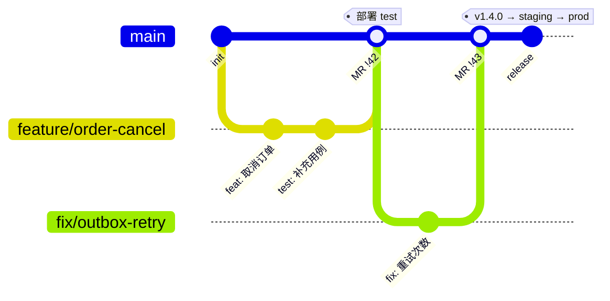
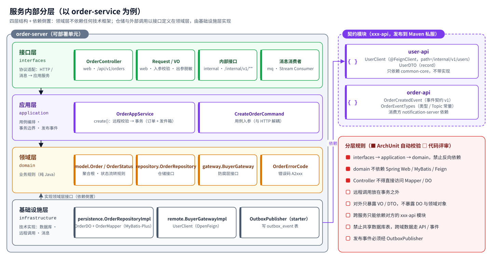
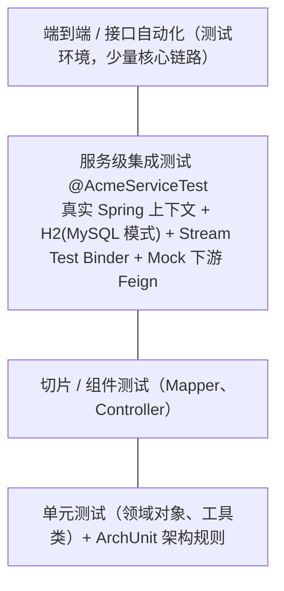

# 第 3 章 Spring Cloud 团队开发规范

> 规范的目标是让 30~100 人、10~50 个服务的团队写出“看起来像一个人写的”代码。
> 能自动化的规范都已经固化在初始工程里（starter 默认值、ArchUnit、CI 检查）；本章说明**为什么**以及**自动化覆盖不到的部分**。
> 标记说明：🔒 由工程或 CI 强制；👀 代码评审检查。

## 3.1 服务拆分与命名

### 3.1.1 拆分原则

- 按**业务能力 / 限界上下文**拆分（用户、订单、支付、库存、通知……），而不是按技术层拆分（不要出现 `dao-service`、`common-service`）；
- 一个服务由**一个团队**负责，一个团队可以负责多个服务；
- 一个服务**独占自己的数据库**，其它服务只能通过 API 或事件获取它的数据；
- 拆分粒度宁粗勿细：初期 5~10 个服务即可，出现明确的独立扩缩容、独立发布、团队边界需求时再拆。

### 3.1.2 命名对照表

| 对象 | 规则 | 示例 |
| --- | --- | --- |
| 服务名（`spring.application.name`、Nacos、K8s） | `<领域>-service`，小写中划线 | `order-service` |
| Maven 模块 | `<领域>-api`、`<领域>-server` | `order-api`、`order-server` |
| Java 包 | `com.acme.<领域>` | `com.acme.order` |
| 数据库 | `acme_<领域>` | `acme_order` |
| 表 | `<业务实体>`，单数，小写下划线；避开保留字 | `order_info`、`user_account` |
| Topic / Exchange | `acme.<领域>.events` | `acme.order.events` |
| 事件类型 | `<领域>.<过去式动词>` | `order.created`、`order.cancelled` |
| 消费组 | 服务名 | `notification-service` |
| 死信 Topic | `<topic>.<消费组>.dlq` | `acme.order.events.notification-service.dlq` |
| Nacos Data ID | `<服务名>.yaml`；共享 `acme-common.yaml` | `order-service.yaml` |
| 错误码号段 | 每个服务分配 1000 个号段 | user `A1xxx`、order `A2xxx` |
| 本地端口 | 网关 8080、认证 9000、服务 81xx（管理端口 91xx）；K8s 中统一 8080 / 8081 | `order-service` 8102 / 9102 |

## 3.2 代码仓库与分支

### 3.2.1 仓库策略

| 策略 | 适用 | 说明 |
| --- | --- | --- |
| **单仓（Monorepo，本工程默认）** | 服务数 < 30，团队在同一组织 | 跨服务重构、统一升级版本最方便；CI 按变更路径只构建受影响模块（`mvn -pl <module> -am`） |
| 平台库独立 + 业务多仓 | 服务数多、团队多 | `acme-framework` 独立仓库，发布到 Nexus（SemVer 版本）；每个领域一个仓库，依赖固定版本的平台 BOM |

### 3.2.2 分支模型：主干开发 + 短分支



| 规则 | 说明 |
| --- | --- |
| `main` 永远可发布 🔒 | 受保护分支，只能通过 MR 合入；CI（编译、测试、ArchUnit、Sonar）必须通过 |
| 短分支 | `feature/*`、`fix/*`，生命周期 ≤ 3 天；未完成功能用功能开关（Nacos 配置）隐藏 |
| Code Review 🔒 | 至少 1 人批准；涉及 `xxx-api`、数据库脚本、安全配置时需对应负责人批准（CODEOWNERS） |
| 提交信息 | Conventional Commits：`feat:`、`fix:`、`refactor:`、`test:`、`docs:`、`chore:`；可附 `(order)` 范围 |
| 版本 | 服务镜像以 Git SHA 标识；对外发布时打 tag `vX.Y.Z`；`xxx-api` 与平台 starter 遵循 SemVer |
| 紧急修复 | 仍然走 `fix/*` → MR → `main`，通过 GitOps 快速晋级，**不在生产分支上直接修改** |

## 3.3 工程与包结构

每个服务由两个 Maven 模块组成：

```text
order-service/
├── order-api/                      # 契约：发布到私服，其它服务依赖
│   └── com/acme/order/api/
│       ├── OrderClient.java        # （如对外提供同步接口）@FeignClient
│       ├── dto/                    # 跨服务 DTO（record）
│       └── event/                  # 领域事件 + 事件类型常量
└── order-server/                   # 可部署应用（一个镜像）
    └── com/acme/order/
        ├── OrderApplication.java
        ├── interfaces/             # 接口层：web / internal / mq
        ├── application/            # 应用层：XxxAppService、XxxCommand
        ├── domain/                 # 领域层：model / repository / gateway / XxxErrorCode
        └── infrastructure/         # 基础设施层：persistence / remote / 其它适配器
```

### 3.3.1 类命名

| 后缀 / 类型 | 所在层 | 职责 |
| --- | --- | --- |
| `XxxController` | interfaces.web | 对外 REST（`/api/v1/**`） |
| `XxxInternalController` | interfaces.internal | 集群内接口（`/internal/v1/**`） |
| `XxxConsumerConfig` | interfaces.mq | Stream 消费者函数 |
| `XxxRequest` / `XxxVO` | interfaces | 入参（带校验注解）/ 出参视图 |
| `XxxAppService` | application | 用例编排、事务边界 |
| `XxxCommand` / `XxxQuery` | application | 用例入参 |
| 领域实体（无后缀） | domain.model | 聚合根、实体、值对象 |
| `XxxRepository` | domain.repository | 仓储接口 |
| `XxxGateway` | domain.gateway | 外部能力接口（防腐层） |
| `XxxErrorCode` | domain | 错误码枚举 |
| `XxxRepositoryImpl`、`XxxDO`、`XxxMapper` | infrastructure.persistence | 仓储实现、表映射、MyBatis Mapper |
| `XxxGatewayImpl` | infrastructure.remote | 通过 Feign / SDK 实现外部能力 |
| `XxxDTO` | xxx-api | 跨服务传输对象 |
| `XxxEvent` | xxx-api.event | 领域事件（过去式命名） |

## 3.4 分层规范



| 层 | 可以做 | 不可以做 |
| --- | --- | --- |
| interfaces | 参数校验、身份解析（JWT → uid）、VO 转换、调用应用服务 | 写业务规则、开启事务、直接访问 Mapper 🔒 |
| application | 编排领域对象与仓储、事务边界、调用 Gateway、发布事件（Outbox） | 写 if/else 业务规则（应下沉到领域对象）、依赖 HTTP 类型 |
| domain | 业务规则、状态流转、定义仓储与网关接口 | 依赖 Spring Web / MyBatis / Feign 🔒、依赖 infrastructure 🔒 |
| infrastructure | 实现仓储与网关接口、技术细节 | 被 interfaces 直接调用 🔒、包含业务规则 |

**依赖规则**由 `acme-starter-test` 中的 `AcmeArchitectureRules` 以 ArchUnit 测试固化，每个服务都有一个 `ArchitectureTest`，违反即构建失败。

> **简单 CRUD 服务也要分层吗？** 要保持目录结构一致，但允许“薄”：领域对象可以只是数据载体，应用服务直接调用仓储。一致的结构让任何人都能快速找到代码。

## 3.5 API 设计规范

### 3.5.1 URL 与方法

| 规则 | 示例 |
| --- | --- |
| 对外接口前缀 `/api/v{n}/`，资源用复数名词 | `GET /api/v1/orders/{id}` |
| 集群内接口前缀 `/internal/v{n}/`，网关不路由 🔒 | `GET /internal/v1/users/{id}` |
| 动作类操作用子资源 | `POST /api/v1/orders/{id}/cancel` |
| 查询用 GET + 查询参数；分页参数 `pageNo`（从 1 开始）、`pageSize`（≤100） | `GET /api/v1/notifications?pageNo=1&pageSize=20` |
| 创建返回 201，删除返回 204 | |
| 不兼容变更升级版本号 `v2`，旧版本至少保留一个发布周期 | |

### 3.5.2 统一响应与错误码

所有接口返回 `Result<T>`，**同时**使用正确的 HTTP 状态码 🔒：

```json
{ "code": "A2002", "message": "下单用户不存在或已被禁用", "data": null, "traceId": "4bf92f3577b34da6a3ce929d0e0e4736" }
```

| 规则 | 说明 |
| --- | --- |
| 错误码格式 | 5 位：首字母 `A` 调用方错误 / `B` 本系统错误 / `C` 第三方或下游错误，后 4 位数字；成功为 `00000`（参考《阿里巴巴 Java 开发手册》） |
| 号段 | 平台 `0000-0999`；每个服务 1000 个号段，在服务的 `XxxErrorCode` 枚举中定义 |
| HTTP 状态 | 由 `ErrorCode.httpStatus()` 决定：400 参数、401 未认证、403 无权限、404 不存在、409 冲突、422 业务规则不满足、429 限流、5xx 系统错误 |
| 业务失败 | 抛 `BizException(ErrorCode, args...)`，由全局异常处理器转换；**不要**在 Controller 里 try/catch 拼 Result |
| 未知异常 | 统一返回 `B0001`，不暴露堆栈与内部信息；日志以 ERROR 记录并告警 |
| traceId | 错误响应体与响应头 `X-Trace-Id` 都带上，便于用户反馈定位 |

### 3.5.3 数据格式

| 项目 | 规则 |
| --- | --- |
| 字段命名 | JSON 使用 lowerCamelCase |
| ID | Long 型 ID 以**字符串**输出（雪花 ID 超出 JS 安全整数）🔒 |
| 时间 | ISO-8601（`2026-10-23T08:00:00Z` 或带时区偏移）；服务内部统一使用 `Instant` / `OffsetDateTime` |
| 金额 | `BigDecimal`，以元为单位、两位小数（或统一以分为单位的 `long`，全系统只能二选一） |
| 枚举 | 输出字符串名（`CREATED`），不输出序号 |
| 敏感信息 | 手机号、身份证、银行卡在 VO 中脱敏输出（`138****1234`） |
| 写接口幂等 | 客户端可传 `Idempotency-Key` 请求头；创建类接口需在服务端去重（唯一约束或幂等表） |

### 3.5.4 文档

- 使用 springdoc（`@Tag`、`@Operation`），test 环境开启 Swagger UI，staging / prod 关闭 🔒；
- `xxx-api` 模块的 Javadoc 即服务间契约文档，修改需服务负责人评审。

## 3.6 服务间调用规范

| # | 规则 |
| --- | --- |
| 1 | 只能依赖对方的 `xxx-api` 模块，**禁止**复制对方的 DTO 或直接写 URL 👀 |
| 2 | Feign 接口必须指定 `contextId` 👀；超时默认由平台提供（连接 1s / 读取 3s）🔒，确需调整时按 `contextId` 单独配置 |
| 3 | **远程调用不得放在数据库事务内**（会长时间占用连接）：先调用、后开事务，见 `OrderAppService#create` 👀 |
| 4 | 不在循环中调用远程接口，提供批量接口（`/internal/v1/users?ids=1,2,3`）👀 |
| 5 | 禁止服务间循环依赖（A 同步调用 B，B 又同步调用 A）；需要反向通知时用事件 👀 |
| 6 | 调用方通过 `infrastructure.remote` 中的适配器调用，把下游错误翻译为本服务语义（防腐层）👀 |
| 7 | 同步调用链深度 ≤ 3；更长的流程改为事件驱动 👀 |
| 8 | 新增 `/internal` 接口同样要做参数校验与鉴权（服务侧也校验 JWT）🔒 |

## 3.7 数据库规范

### 3.7.1 基本规则

| # | 规则 |
| --- | --- |
| 1 | 一服务一库，**禁止跨库访问与跨服务 JOIN** 🔒（账号权限只授予本服务库） |
| 2 | 每张表必须包含公共字段：`id BIGINT` 主键、`created_at`、`updated_at`、`deleted`、`version` 🔒（`BaseDO`） |
| 3 | 主键使用雪花算法（MyBatis-Plus `ASSIGN_ID`），不使用自增；不使用 UUID 字符串主键（索引离散） |
| 4 | 不使用外键、触发器、存储过程；约束在应用层或通过唯一索引实现 |
| 5 | 字符集 `utf8mb4`（MySQL）；时间列 `DATETIME(3)` / `TIMESTAMP(3)`；金额 `DECIMAL(18,2)` / `NUMERIC(18,2)` |
| 6 | 索引命名 `uk_<表>_<列>`、`idx_<表>_<列>`；单表索引 ≤ 5 个；联合索引遵循最左前缀 |
| 7 | 禁止 `SELECT *`（MyBatis-Plus 默认列出字段）；分页单页 ≤ 500 🔒（分页插件限制） |
| 8 | 禁止无条件的 UPDATE / DELETE 🔒（`BlockAttackInnerInterceptor`） |
| 9 | 逻辑删除使用 `deleted` 字段；唯一索引需考虑已删除数据（必要时把 `deleted` 设计为删除时间戳并加入唯一索引） |
| 10 | 单表超过 2000 万行或 50GB 前规划归档 / 分库分表（ShardingSphere 或 PolarDB-X） |

### 3.7.2 数据库变更（Flyway）

- 脚本位置：`src/main/resources/db/migration/{mysql|postgresql}/`，由 `spring.flyway.locations=classpath:db/migration/{vendor}` 按数据库自动选择 🔒；
- 命名：`V<主版本>_<次版本>_<序号>__<描述>.sql`，例如 `V1_0_1__outbox.sql`；
- **已在任何共享环境执行过的脚本禁止修改**，只能追加新版本（Flyway 校验和会失败）🔒；
- 变更必须向前兼容，按“扩展 → 迁移 → 收缩”分两个版本完成：先加新列并双写，下个版本再删旧列；
- 大表 DDL 使用 Online DDL（MySQL `ALGORITHM=INPLACE` / gh-ost / pt-osc，PostgreSQL `CREATE INDEX CONCURRENTLY`），由 DBA 在变更窗口执行，Flyway 脚本中记录为已执行；
- 生产禁止 `flyway clean` 🔒（`spring.flyway.clean-disabled=true`）。

### 3.7.3 同时支持 MySQL 与 PostgreSQL 时

- 两套脚本内容等价，CI 中各跑一次集成测试（Testcontainers）；
- 只使用两者都支持的 SQL：`LIMIT/OFFSET`、`FOR UPDATE SKIP LOCKED`、标准 `CASE`；不使用 `ON DUPLICATE KEY UPDATE` / `ON CONFLICT` 等方言（确需时在 Mapper XML 中按 `databaseId` 分开写）；
- 布尔 / 状态字段用 `SMALLINT`/`TINYINT` 或 `VARCHAR` 枚举名，避免 `BOOLEAN` 与 `TINYINT(1)` 的差异；
- 项目确定数据库后，删除另一套脚本与驱动，避免长期维护两份。

## 3.8 消息规范

| # | 规则 |
| --- | --- |
| 1 | 发布事件**必须**通过 `OutboxPublisher`，且在本地事务内调用（否则抛异常）🔒 |
| 2 | 消费**必须**幂等：通过 `IdempotentConsumer` 或业务唯一约束 👀 |
| 3 | 事件是**事实**（过去式）：`order.created`，不是命令 `create.order` |
| 4 | 事件契约放在 `xxx-api/event`，只做向后兼容的修改：可以加字段，不能删除或改名；不兼容时发布新类型 `order.created.v2` 👀 |
| 5 | 消费方必须容忍未知字段：Spring Boot 默认关闭 `FAIL_ON_UNKNOWN_PROPERTIES`，不要打开它（`OrderCreatedConsumerTest` 中有覆盖） |
| 6 | 事件只携带必要数据（ID + 关键字段），单条消息 < 64KB；大对象传引用（OSS key） |
| 7 | 需要顺序的事件以聚合根 ID 为 key（Kafka 分区 / RabbitMQ 单活消费者） |
| 8 | 重试 3 次（指数退避）后进入 DLQ；DLQ 有消息即告警，由补偿工具人工重放 🔒（配置） |
| 9 | Topic 由平台以代码方式创建（Strimzi `KafkaTopic` / 云控制台 / Terraform），应用关闭自动建 topic 🔒 |
| 10 | 消息头使用 `acme_event_*`，**不要使用 `ce_` 前缀**（会被 Spring Cloud Function 改写） |

## 3.9 配置规范

| 配置 | 位置 | 规则 |
| --- | --- | --- |
| 平台默认值 | starter `META-INF/acme/defaults/*.yml` | 由平台组维护，业务服务不重复声明 |
| 服务固定配置 | `application.yml` | 不出现任何环境相关值（地址、密码）🔒 |
| 环境差异（部署） | `deploy/gitops/envs/<env>/<服务>.yaml` | 通过 MR 修改，生产需审批 |
| 动态业务配置 | Nacos `<服务名>.yaml` | 生产变更走变更单；重要变更先 Beta 发布 |
| 凭据 | Vault / KMS → ExternalSecret → Secret | **禁止**出现在 Git、Nacos、镜像、日志中（建议 CI 增加 gitleaks 密钥扫描） |
| 功能开关 | Nacos，使用 `@ConfigurationProperties`（JavaBean 风格可动态刷新） | 开关有负责人与下线时间 |

Spring Profile 只用于本地开发（`local`），**不用 Profile 区分 test / staging / prod**——环境差异来自外部，镜像保持一致。

## 3.10 日志与可观测规范

| # | 规则 |
| --- | --- |
| 1 | 使用 SLF4J 占位符：`log.info("下单成功 orderId={}", id)`，禁止字符串拼接 |
| 2 | 级别：ERROR 需要人工处理（会告警）；WARN 可自动恢复的异常；INFO 关键业务节点；DEBUG 调试细节（生产关闭） |
| 3 | 禁止打印密码、令牌、完整手机号 / 身份证 / 银行卡；请求体日志默认关闭 👀 |
| 4 | 业务异常（`BizException`）不打印堆栈；未知异常打印一次堆栈（由全局处理器负责，业务代码不要 catch 后再打印）|
| 5 | K8s 中输出 JSON 到 stdout（`LOGGING_STRUCTURED_FORMAT_CONSOLE=ecs`），不写本地文件 🔒（Helm 默认） |
| 6 | 自定义指标使用 Micrometer，命名 `acme.<领域>.<指标>`，如 `acme.order.created`；标签基数受控（不要用 userId 做标签） |
| 7 | 每个服务上线前在 Grafana / ARMS 有大盘，核心接口配置 SLO 告警 |

## 3.11 安全规范

| # | 规则 |
| --- | --- |
| 1 | 所有接口默认需要认证 🔒（`acme-starter-security`）；匿名接口必须显式放行并评审 |
| 2 | 用户身份只从 JWT 的 `uid` 获取，**禁止**信任请求参数 / 请求体中的 userId 👀 |
| 3 | 数据级权限：查询“我的”数据时必须带上 uid 条件；不属于当前用户的资源返回 404 而不是 403 |
| 4 | 管理类接口使用 `@PreAuthorize("hasRole('ADMIN')")` |
| 5 | 入参全部使用 Bean Validation 校验；SQL 只用 MyBatis 参数绑定（`#{}`），禁止 `${}` 拼接用户输入 |
| 6 | 敏感数据存储加密（手机号、身份证使用 KMS 数据密钥加密 + 哈希索引） |
| 7 | 镜像扫描（Trivy / ACR）在 CI 中阻断严重漏洞 🔒（`deploy/ci/gitlab-ci.yml`）；依赖漏洞扫描建议接入 Sonar 或 OWASP Dependency-Check |
| 8 | 容器以非 root 运行、只读根文件系统、丢弃全部 capabilities 🔒（Helm 默认） |
| 9 | 生产访问通过堡垒机，所有操作留痕；`kubectl exec` 进生产容器需审批 |

## 3.12 测试规范



| # | 规则 |
| --- | --- |
| 1 | 领域对象的业务规则必须有单元测试 |
| 2 | 每个服务至少一组 `@AcmeServiceTest`，覆盖核心用例的完整链路（HTTP → 数据库 → 发件箱 → 消息） |
| 3 | 下游服务用 `@MockitoBean` 模拟 Feign 接口；消息用 `InputDestination` / `OutputDestination` 收发 |
| 4 | 每个服务有 `ArchitectureTest` 🔒 |
| 5 | 需要验证数据库方言、锁、Kafka 语义时使用 Testcontainers（CI 提供 Docker），MySQL 与 PostgreSQL 各跑一次 |
| 6 | 行覆盖率门槛 70%、新代码 80%：建议接入 JaCoCo 并在 Sonar 质量门禁中设置 |
| 7 | 测试数据由测试自己准备，不依赖执行顺序；不访问共享环境 |

## 3.13 部署与运行规范

| # | 规则 |
| --- | --- |
| 1 | 所有服务使用通用 Chart `deploy/helm/acme-service`，只在 `envs/<env>/<服务>.yaml` 中覆盖差异 🔒 |
| 2 | 内存 request = limit；CPU 只设 request 不设 limit（避免 JVM 被 CFS 限流） |
| 3 | JVM：`-XX:MaxRAMPercentage=75`、G1、`-XX:+ExitOnOutOfMemoryError`（OOM 时让 K8s 重启） |
| 4 | 探针走管理端口 8081：startup → liveness → readiness；liveness 不检查下游依赖 |
| 5 | 优雅停机：`preStop` 10s + `server.shutdown=graceful` 30s，`terminationGracePeriodSeconds` 60s |
| 6 | 生产 ≥3 副本，HPA + PDB，跨可用区打散 |
| 7 | 生产按镜像 digest 部署，禁止 `latest` |
| 8 | 每个服务一个 ServiceAccount，默认不挂载 K8s Token；云权限通过 RRSA / IRSA / Workload Identity 授予 |

## 3.14 代码评审清单

- [ ] 分层正确：Controller 无业务逻辑，领域规则在领域对象中，基础设施实现领域接口
- [ ] 事务边界在应用服务；事务内没有远程调用、没有耗时操作
- [ ] 跨服务调用通过 `xxx-api`，有防腐适配；没有循环依赖、没有循环内调用
- [ ] 发布事件使用 Outbox；消费幂等；事件契约兼容
- [ ] 错误使用 `BizException` + 本服务错误码；没有吞掉异常
- [ ] 用户身份来自 JWT；数据权限正确；敏感字段脱敏
- [ ] 入参校验完整；分页有上限
- [ ] 数据库脚本向前兼容、有索引、两种数据库脚本同步
- [ ] 日志级别恰当、无敏感信息；新增指标的标签基数可控
- [ ] 新增配置放对位置（Nacos / values / Secret），有默认值
- [ ] 有对应测试；`mvn verify` 通过

## 3.15 新服务接入流程

1. **立项评审**：明确限界上下文、数据归属、对外接口与事件、负责人；分配错误码号段与端口；
2. **创建模块**：复制 `acme-services/user-service`，批量替换名称（见第 4 章 4.7）；
3. **申请资源**：数据库（`acme_<领域>`）与账号、Nacos 配置、Topic、Vault / KMS 凭据路径、域名（如需）；
4. **配置部署**：在 `deploy/gitops/envs/{test,staging,prod}/` 新增 values 文件，新增 ExternalSecret；
5. **可观测**：大盘、告警规则、日志索引；
6. **上线检查**：压测报告（staging）、回滚预案、值班人；
7. 合入 `main` → 自动部署测试环境 → 按发布流程晋级。
