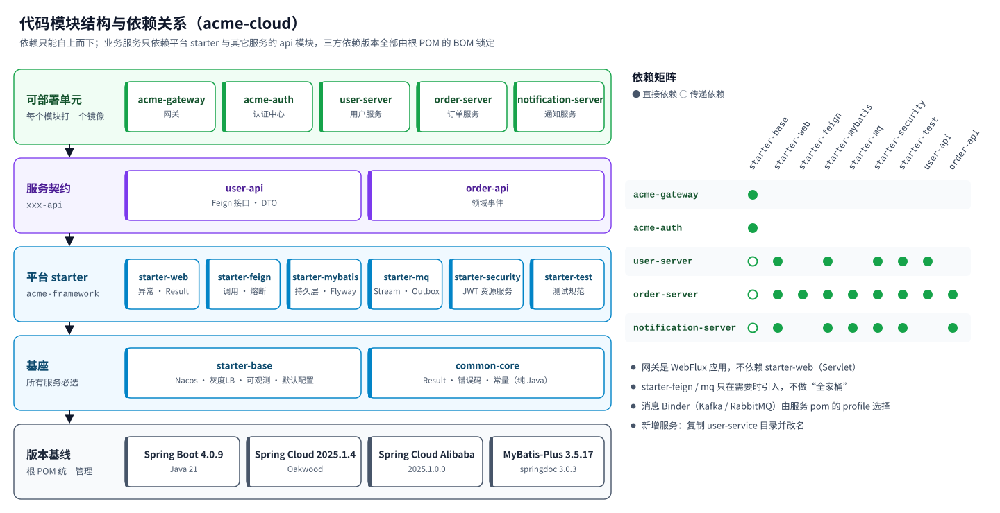

# 第 4 章 初始代码结构

> 初始工程位于仓库的 [`acme-cloud/`](../acme-cloud) 目录，是一个**可编译、可测试、可部署**的 Maven 多模块项目，覆盖前三章提到的全部技术：
> Nacos 注册/配置、Spring Cloud Gateway、OpenFeign + LoadBalancer（灰度）、CircuitBreaker（Resilience4j）、Spring Cloud Stream（Kafka / RabbitMQ）+ 事务发件箱、Spring Authorization Server + Resource Server、MyBatis-Plus + Flyway（MySQL / PostgreSQL）、Micrometer + OpenTelemetry、Helm + Argo CD。
> `mvn verify` 包含 20 个模块、30 个测试（单元、服务级集成、ArchUnit）。

## 4.1 模块全景



## 4.2 目录树

```text
acme-cloud/
├── pom.xml                                   # 根 POM：继承 Spring Boot Parent，导入 Spring Cloud / Alibaba / MyBatis-Plus BOM
│
├── acme-framework/                           # ① 平台公共层（平台组维护，业务团队只引用）
│   ├── acme-common-core/                     #   纯 Java：Result、PageResult、ErrorCode、BizException、AcmeHeaders
│   ├── acme-starter-base/                    #   所有可部署单元的基座
│   │   ├── AcmeDefaultsEnvironmentPostProcessor.java   # 以最低优先级加载 META-INF/acme/defaults/*.yml
│   │   ├── loadbalancer/GrayServiceInstanceListSupplier.java  # 灰度实例筛选（网关与 Feign 共用）
│   │   └── META-INF/acme/defaults/00-base.yml           # Nacos、探针、优雅停机、指标、链路默认值
│   ├── acme-starter-web/                     #   Servlet 服务：全局异常处理、X-Trace-Id、Long→String、springdoc
│   ├── acme-starter-feign/                   #   OpenFeign + hc5 + Resilience4j + 请求头透传 + 错误解码
│   ├── acme-starter-mybatis/                 #   MyBatis-Plus（分页/乐观锁/防全表更新/审计字段）+ Flyway + 双数据库驱动
│   ├── acme-starter-mq/                      #   Spring Cloud Stream + OutboxPublisher / OutboxRelay + IdempotentConsumer
│   ├── acme-starter-security/                #   OAuth2 资源服务器：JWT → uid / ROLE_* / SCOPE_*，401/403 统一响应
│   └── acme-starter-test/                    #   @AcmeServiceTest、AcmeArchitectureRules（ArchUnit）、测试配置
│
├── acme-gateway/                             # ② API 网关（Spring Cloud Gateway / WebFlux）
│   └── com/acme/gateway/
│       ├── config/GatewaySecurityConfig.java #   JWT 校验
│       ├── config/RateLimitConfig.java       #   限流 KeyResolver（用户 / IP）
│       ├── config/GrayProperties.java        #   灰度规则（Nacos 动态配置）
│       ├── filter/BlockInternalPathFilter.java  # 屏蔽 /internal/**（排在 Security 之前）
│       ├── filter/GrayTagFilter.java         #   按 uid 白名单 / 百分比打 X-Gray-Tag
│       └── web/FallbackController.java       #   熔断降级响应
│
├── acme-auth/                                # ③ 认证中心（Spring Authorization Server）
│   └── com/acme/auth/AuthServerConfig.java   #   JWK（PEM 挂载 / 本地临时生成）、用户、uid/roles 声明
│
├── acme-services/                            # ④ 业务服务（每个服务 = api + server）
│   ├── user-service/
│   │   ├── user-api/                         #   UserClient（@FeignClient）、UserDTO —— 发布到私服
│   │   └── user-server/
│   │       ├── src/main/java/com/acme/user/
│   │       │   ├── interfaces/web/           #     UserController、RegisterUserRequest、UserVO（脱敏）
│   │       │   ├── interfaces/internal/      #     UserInternalController（/internal/v1/users）
│   │       │   ├── application/              #     UserAppService、RegisterUserCommand
│   │       │   ├── domain/                   #     User、UserStatus、UserRepository、UserErrorCode
│   │       │   └── infrastructure/persistence/  #  UserDO、UserMapper、UserRepositoryImpl、MapStruct 转换器
│   │       ├── src/main/resources/
│   │       │   ├── application.yml           #     只写本服务特有配置（十几行）
│   │       │   └── db/migration/{mysql,postgresql}/V1_0_0__init_user.sql
│   │       └── src/test/java/…/              #     UserApiIntegrationTest、ArchitectureTest
│   ├── order-service/
│   │   ├── order-api/                        #   OrderCreatedEvent、OrderEventTypes（事件契约）
│   │   └── order-server/                     #   下单：Feign 校验买家 → 事务（订单 + 发件箱）→ Stream 投递
│   │       ├── …/domain/gateway/BuyerGateway.java          # 防腐层接口
│   │       ├── …/infrastructure/remote/BuyerGatewayImpl.java # 通过 UserClient 实现
│   │       └── db/migration/{mysql,postgresql}/V1_0_1__outbox.sql
│   └── notification-service/
│       └── notification-server/              #   Stream 函数式消费者 + 幂等 + DLQ；分页查询通知
│
└── deploy/                                   # ⑤ 交付与运行
    ├── docker/Dockerfile                     #   通用分层镜像（非 root）
    ├── local/docker-compose.yml              #   本地中间件：MySQL、Nacos、Kafka、Redis、Jaeger（+ PG / RabbitMQ profile）
    ├── helm/acme-service/                    #   通用 Chart：Deployment、Service、HPA、PDB、NetworkPolicy、ServiceMonitor、Ingress
    ├── gitops/
    │   ├── argocd/applicationsets.yaml       #   test / staging 自动同步，prod 手动 Sync
    │   └── envs/{test,staging,prod}/*.yaml   #   每个服务每个环境一份 values（含生产灰度示例）
    ├── k8s/platform/                         #   命名空间、platform-env（自建 / 阿里云）、ExternalSecret、KafkaTopic
    ├── nacos/{test,staging,prod}/            #   Nacos 配置样例（acme-common、acme-gateway、order-service）
    └── ci/gitlab-ci.yml                      #   GitLab 流水线模板（verify → image → test → staging → prod）
```

## 4.3 平台 starter 一览

| 模块 | 自动配置 / 主要类 | 默认配置文件 | 业务服务何时引入 |
| --- | --- | --- | --- |
| `acme-common-core` | `Result`、`PageResult`、`ErrorCode`、`CommonErrorCode`、`BizException`、`RemoteServiceException`、`AcmeHeaders` | — | 总是（传递引入） |
| `acme-starter-base` | `AcmeDefaultsEnvironmentPostProcessor`、`AcmeLoadBalancerAutoConfiguration`（灰度） | `00-base.yml` | 总是（含网关、认证中心） |
| `acme-starter-web` | `GlobalExceptionHandler`、`TraceIdResponseFilter`、Long→String 序列化 | `10-web.yml` | Servlet 服务 |
| `acme-starter-feign` | `HeaderRelayRequestInterceptor`、`AcmeFeignErrorDecoder` | `20-feign.yml` | 需要同步调用其它服务时 |
| `acme-starter-mybatis` | `BaseDO`、`AuditMetaObjectHandler`、`MybatisPlusInterceptor`、`Pages` | `30-mybatis.yml` | 有数据库时 |
| `acme-starter-mq` | `OutboxPublisher`、`OutboxRelay`、`IdempotentConsumer`、`EventHeaders` | `40-mq.yml` | 发布或消费事件时 |
| `acme-starter-security` | `AcmeSecurityAutoConfiguration`（SecurityFilterChain、JWT 权限映射）、`SecurityExceptionHandler` | `50-security.yml` | 对外提供接口的服务 |
| `acme-starter-test` | `@AcmeServiceTest`、`AcmeArchitectureRules`、`acme-test.properties` | — | test 作用域 |

## 4.4 关键代码导读

### 4.4.1 “默认正确”的平台配置

`acme-starter-base` 中的 `EnvironmentPostProcessor` 在 ConfigData（`application.yml`、Nacos）加载**之后**运行，把各 starter 的默认配置追加到**最低优先级**：

```java
public class AcmeDefaultsEnvironmentPostProcessor implements EnvironmentPostProcessor, Ordered {
    static final String LOCATION = "classpath*:META-INF/acme/defaults/*.yml";

    @Override
    public void postProcessEnvironment(ConfigurableEnvironment environment, SpringApplication application) {
        // 逐个加载 yml，放在 defaultProperties 之前（即除默认属性外优先级最低）
    }

    @Override
    public int getOrder() {
        return ConfigDataEnvironmentPostProcessor.ORDER + 1;
    }
}
```

因此业务服务的 `application.yml` 只需要：

```yaml
spring:
  application:
    name: order-service
  config:
    import:
      - optional:nacos:acme-common.yaml
      - optional:nacos:${spring.application.name}.yaml
  datasource:
    url: ${DB_URL:jdbc:mysql://127.0.0.1:3306/acme_order?...}
```

### 4.4.2 下单：远程调用在事务外，事件与数据同事务

`acme-services/order-service/order-server/.../application/OrderAppService.java`：

```java
public Order create(CreateOrderCommand command) {
    if (!buyerGateway.canPlaceOrder(command.userId())) {          // ① Feign 调用 user-service（事务外）
        throw new BizException(OrderErrorCode.BUYER_NOT_AVAILABLE);
    }
    return transactionTemplate.execute(status -> {                  // ② 本地事务
        Order order = Order.create(orderRepository.nextId(), command.userId(), command.productCode(),
                command.quantity(), command.amount(), Instant.now(clock));
        orderRepository.add(order);
        outboxPublisher.publish(ORDER_EVENTS_BINDING, OrderEventTypes.ORDER_CREATED,   // ③ 写发件箱
                order.getId().toString(), new OrderCreatedEvent(...));
        return order;
    });
}
```

### 4.4.3 防腐层：把下游错误翻译成本域语义

```java
@Component
public class BuyerGatewayImpl implements BuyerGateway {            // infrastructure.remote
    public boolean canPlaceOrder(Long userId) {
        try {
            Result<UserDTO> result = userClient.getUser(userId);
            return result.isSuccess() && result.data() != null && result.data().isActive();
        } catch (BizException ex) {        // 下游 4xx（用户不存在）→ 不可下单
            return false;
        }                                  // 下游 5xx / 熔断 → RemoteServiceException 原样抛出 → C0001/C0503
    }
}
```

### 4.4.4 灰度负载均衡

```java
static List<ServiceInstance> select(List<ServiceInstance> instances, String grayTag) {
    List<ServiceInstance> stable = instances.stream().filter(i -> !StringUtils.hasText(tagOf(i))).toList();
    if (StringUtils.hasText(grayTag)) {
        List<ServiceInstance> gray = instances.stream().filter(i -> grayTag.equals(tagOf(i))).toList();
        if (!gray.isEmpty()) {
            return gray;                   // 带标签的请求 → 同标签实例
        }
    }
    return stable.isEmpty() ? instances : stable;   // 普通请求 → 只走稳定实例
}
```

通过 `@LoadBalancerClients(defaultConfiguration = GrayLoadBalancerClientConfiguration.class)` 对所有下游生效，Servlet（Feign）与 WebFlux（网关）分别使用阻塞 / 响应式的服务发现。

### 4.4.5 幂等消费

```java
public <T> boolean consume(Message<T> message, Consumer<T> handler) {
    String eventId = message.getHeaders().get(EventHeaders.ID, String.class);
    return Boolean.TRUE.equals(transactionTemplate.execute(status -> {
        try {
            jdbcTemplate.update("INSERT INTO consumed_event (consumer, event_id, consumed_at) VALUES (?, ?, ?)", ...);
        } catch (DuplicateKeyException ex) {
            return false;                  // 重复投递：跳过
        }
        handler.accept(message.getPayload());   // 与登记在同一事务
        return true;
    }));
}
```

### 4.4.6 测试：一个注解启动完整服务

```java
@AcmeServiceTest            // Nacos 关闭 · H2(MySQL 模式) 执行真实 Flyway 脚本 · Stream Test Binder
class CreateOrderFlowTest {
    @MockitoBean UserClient userClient;          // 模拟下游 Feign
    @Autowired OutputDestination output;         // 断言发出的消息

    @Test
    void createOrderPublishesOrderCreatedEventThroughOutbox() throws Exception {
        given(userClient.getUser(1001L)).willReturn(Result.ok(new UserDTO(1001L, "alice", "ACTIVE")));
        mvc.perform(post("/api/v1/orders").with(jwt().jwt(t -> t.claim("uid", "1001"))) ...)
           .andExpect(status().isCreated());
        outboxRelay.relay();
        Message<byte[]> message = output.receive(1000, OrderEventTypes.DESTINATION);
        assertThat(message.getHeaders().get(EventHeaders.TYPE)).isEqualTo("order.created");
    }
}
```

| 测试类 | 覆盖内容 |
| --- | --- |
| `GrayServiceInstanceListSupplierTest` | 灰度实例选择的 4 种情况 |
| `UserApiIntegrationTest` | 注册、内部接口契约、409 / 404 / 400 / 403 / 401 统一响应、手机号脱敏、Long→String |
| `CreateOrderFlowTest` | 下单 → 发件箱 → Relay → 消息；越权访问返回 404；下游不存在 422；下游故障 503 |
| `OrderCreatedConsumerTest` | 重复消息只处理一次；忽略同 topic 其它事件；容忍未知字段；分页查询 |
| `GatewayApplicationTest` / `GrayTagFilterTest` | `/internal` 屏蔽、401、降级响应、灰度规则 |
| `AuthServerTest` | OIDC 发现、JWKS、客户端凭证签发令牌 |
| `ArchitectureTest`（每个服务） | 分层依赖、领域层无框架依赖、Controller 不访问持久层 |

## 4.5 本地开发

### 4.5.1 启动中间件

```bash
cd acme-cloud
docker compose -f deploy/local/docker-compose.yml up -d          # MySQL + Nacos + Kafka + Redis + Jaeger
# 使用 PostgreSQL：--profile pg；使用 RabbitMQ：--profile rabbit（并以 -Prabbit 构建服务）
```

首次访问 Nacos 控制台 <http://localhost:18080> 时设置 `nacos` 用户密码为 `nacos`（与服务默认的 `NACOS_PASSWORD` 一致）。本地使用 `public` 命名空间，无需预先创建配置（`optional:nacos:` 导入）。

### 4.5.2 构建与启动服务

```bash
mvn install                              # 编译 + 全部测试（约 2 分钟）
mvn -pl acme-auth spring-boot:run        # 9000
mvn -pl acme-services/user-service/user-server spring-boot:run                    # 8101
mvn -pl acme-services/order-service/order-server spring-boot:run                  # 8102
mvn -pl acme-services/notification-service/notification-server spring-boot:run    # 8103
mvn -pl acme-gateway spring-boot:run     # 8080（统一入口）
```

| 地址 | 说明 |
| --- | --- |
| <http://localhost:8080/api/v1/...> | 经网关访问业务接口 |
| <http://localhost:8102/swagger-ui.html> | 订单服务 API 文档（test / 本地开启） |
| <http://localhost:9102/actuator/prometheus> | 订单服务指标（管理端口） |
| <http://localhost:16686> | Jaeger 链路查询 |

### 4.5.3 获取令牌

- **用户令牌**（授权码 + PKCE）：在 Postman / Insomnia 中选择 OAuth 2.0 → Authorization Code (With PKCE)，Client ID `acme-web`，授权地址 `http://127.0.0.1:9000/oauth2/authorize`，令牌地址 `http://127.0.0.1:9000/oauth2/token`，回调地址需在 `AUTH_WEB_REDIRECT_URIS` 中登记；演示账号 `alice / password`（uid 1001）、`admin / password`（ADMIN）。
- **客户端凭证**（系统调用）：

```bash
curl -u acme-internal:local-only-secret -d 'grant_type=client_credentials&scope=internal' \
     http://127.0.0.1:9000/oauth2/token
```

### 4.5.4 切换数据库与消息中间件

| 切换 | 做法 |
| --- | --- |
| MySQL → PostgreSQL | 设置 `DB_URL=jdbc:postgresql://127.0.0.1:5432/acme_order`；Flyway 自动选择 `db/migration/postgresql` |
| Kafka → RabbitMQ | `mvn package -Prabbit`（镜像中只带 RabbitMQ Binder），设置 `RABBITMQ_ADDRESSES`；代码与 binding 配置不变 |

## 4.6 构建镜像与部署

```bash
# 1. 构建镜像（CI 中执行）
docker build -f deploy/docker/Dockerfile \
  --build-arg MODULE=acme-services/order-service/order-server \
  -t registry.acme.com/acme/order-service:$(git rev-parse --short HEAD) .

# 2. 预览某个环境的渲染结果
helm template order-service deploy/helm/acme-service -f deploy/gitops/envs/prod/order-service.yaml

# 3. 部署：修改 deploy/gitops/envs/<env>/order-service.yaml 中的 image.tag / digest 并合入 main，
#    Argo CD（deploy/gitops/argocd/applicationsets.yaml）自动同步 test / staging，prod 由发布负责人手动 Sync。
```

上线到一个新集群前，平台需准备：命名空间与 `acme-platform-env` ConfigMap（`deploy/k8s/platform/10-*.yaml` 或 `11-*.yaml`）、ExternalSecret（`20-external-secrets.yaml`）、Topic（`30-kafka-topics.yaml`）、Nacos 配置（`deploy/nacos/<env>/`）。

## 4.7 新增一个服务（以 `inventory-service` 为例）

```bash
cd acme-cloud/acme-services
cp -r user-service inventory-service
cd inventory-service && mv user-api inventory-api && mv user-server inventory-server
# 批量替换名称与包名
grep -rl 'user' . | xargs sed -i 's/user-service/inventory-service/g; s/user-api/inventory-api/g; s/user-server/inventory-server/g; s/com\.acme\.user/com.acme.inventory/g'
# 调整目录：src/main/java/com/acme/user → com/acme/inventory，类名 User* → Inventory*
```

然后：

1. 在 `acme-services/pom.xml` 增加 `<module>inventory-service</module>`；在根 POM 的 `dependencyManagement` 中登记 `inventory-api`；
2. 修改 `application.yml`：服务名、本地端口（如 8104 / 9104）、数据库名 `acme_inventory`；
3. 重写 Flyway 脚本与领域代码，分配错误码号段（如 `A4xxx`）；
4. 网关增加路由 `Path=/api/v1/inventories/**`；
5. 新增 `deploy/gitops/envs/{test,staging,prod}/inventory-service.yaml` 与 ExternalSecret；
6. `mvn verify` 通过（`ArchitectureTest` 会立即约束新服务的分层）。

## 4.8 后续可扩展项

初始工程刻意保持精简，以下能力按需接入（选型建议见第 2 章 2.13）：

- 分布式调度（XXL-JOB / SchedulerX）、缓存（Spring Cache + Redis）、分布式锁（Redisson）
- Seata（仅限强一致场景）、Sentinel / MSE 服务治理
- Testcontainers（MySQL / PostgreSQL / Kafka 真实环境集成测试）
- Spring Cloud Contract 契约测试、JaCoCo 覆盖率门禁
- BFF 层（面向前端的聚合服务）、搜索服务（Elasticsearch）
- 管理后台、运营报表（读写分离 / 数据仓库）
