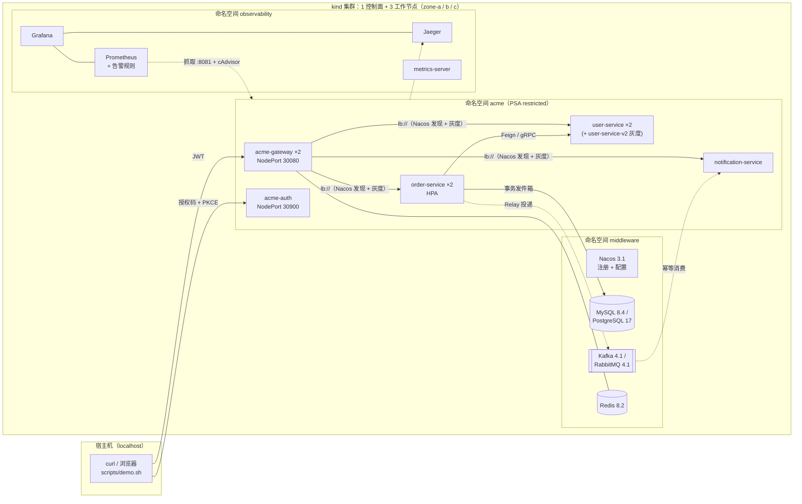
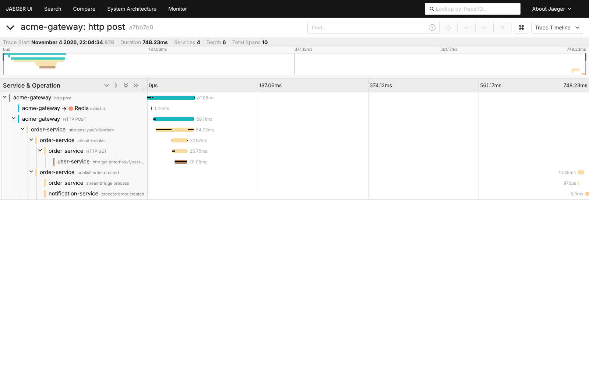
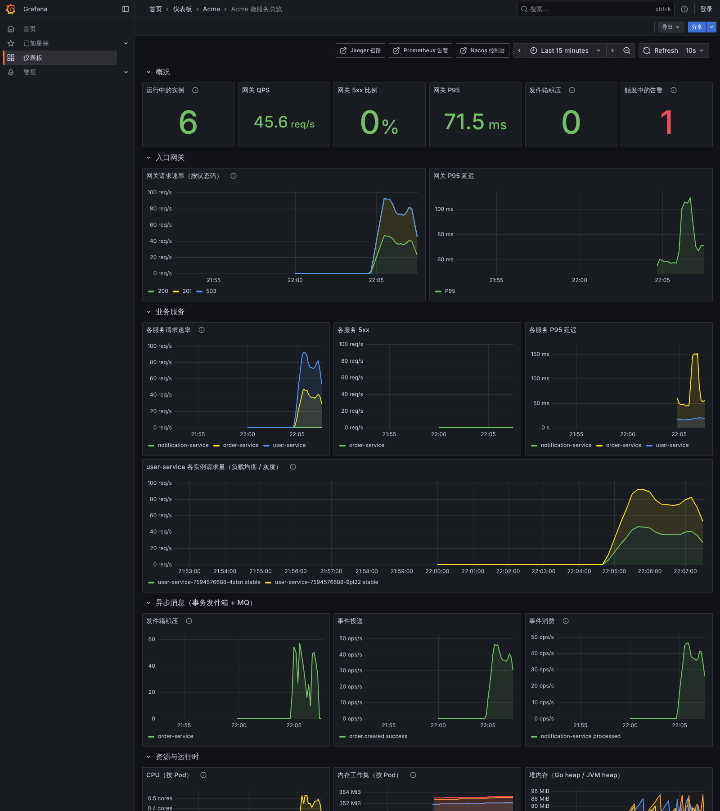

# 本地集群：完整微服务体系演示

在一台电脑上用 **kind** 搭一个多节点 Kubernetes 集群，部署与生产同构的整套微服务体系，并用脚本复现灰度发布、熔断、MQ 宕机、滚动发布等场景，再用 **Jaeger / Prometheus / Grafana / Nacos 控制台**分析系统行为。

两套技术栈共用本目录，命令里的第一个参数选择实现：

| | Spring Cloud 版 | Go 版 |
| --- | --- | --- |
| 业务代码 | [`acme-cloud/`](../acme-cloud) | [`acme-go/`](../acme-go) |
| Helm Chart | `acme-cloud/deploy/helm/acme-service` | `acme-go/deploy/helm/acme-service` |
| 本地环境差异 | [`stacks/spring/`](stacks/spring) | [`stacks/go/`](stacks/go) |
| 一键部署 | `scripts/up.sh spring` | `scripts/up.sh go` |

> 业务服务用的是各工程**生产部署用的同一份 Helm Chart 和 Dockerfile**，本地只多一层 values（相当于在 test / staging / prod 之外多了一个 `local` 环境）。中间件用单副本容器模拟生产中的云产品或中间件集群。

## 1. 集群里有什么



| 体系能力 | 在本地集群中的体现 | 怎么观察 |
| --- | --- | --- |
| 注册发现 | 服务启动后注册到 Nacos `local` 命名空间，网关 / 调用方按实例列表负载均衡 | Nacos 控制台 → 服务列表；`demo.sh <stack> lb` |
| 配置中心 | `stacks/<stack>/nacos/*.yaml` 由初始化 Job 发布；网关灰度规则、限流阈值修改后实时生效 | Nacos 控制台 → 配置列表；`demo.sh <stack> ratelimit` |
| 统一认证 | 认证中心签发 RS256 JWT（授权码 + PKCE），网关与各服务按 JWKS 校验 | `scripts/token.sh <stack> alice` |
| API 网关 | 路由、JWT 校验、按用户限流（Redis）、熔断、灰度打标 | Grafana“入口网关”；Jaeger 中的 `acme-gateway` Span |
| 服务调用 | Spring：OpenFeign + LoadBalancer；Go：gRPC + Kratos 选择器 | Jaeger 中 order → user 的调用 Span |
| 熔断降级 | 依赖下线时快速失败（`503 C0503`），恢复后自动闭合 | `demo.sh <stack> breaker`；Prometheus Alerts |
| 全链路灰度 | 灰度版本以 `grayTag=v2` 独立部署，网关按 Nacos 规则打标，标签随调用链透传 | `demo.sh <stack> gray`；响应头 `X-Served-By` |
| 事务发件箱 + 消息 | 订单与事件同事务写库，Relay 投递，消费端幂等；MQ 宕机期间下单不受影响 | `demo.sh <stack> outbox`；Grafana“异步消息” |
| 可观测 | 一次下单是一条完整链路（含 MQ 异步段）；RED 指标、发件箱积压、JVM / Go 运行时、容器资源 | Jaeger、Grafana、Prometheus |
| 发布与弹性 | 滚动发布零失败、HPA、PDB、跨可用区打散、NetworkPolicy、Pod 安全基线 | `demo.sh <stack> rollout` / `load`；`kubectl get pods -o wide` |

## 2. 前置条件

| 工具 | 版本 | 说明 |
| --- | --- | --- |
| Docker | 24+（Docker Desktop / OrbStack / Colima / Linux dockerd） | 建议分配 **8 GB 内存**（Spring 版）或 6 GB（Go 版）、20 GB 磁盘 |
| [kind](https://kind.sigs.k8s.io/) | 0.30+ | 创建集群 |
| kubectl、[Helm](https://helm.sh/) | kubectl 1.32+、Helm 3.15+ | 部署 |
| JDK 21 + Maven 3.9 | Spring 版 | 在宿主机打包 jar，复用本机 Maven 缓存 |
| Go 1.26 | Go 版 | 在宿主机交叉编译 linux 二进制 |
| curl、openssl | — | 获取令牌（PKCE）与演示脚本 |
| python3（可选） | — | `demo.sh` 打印链路摘要 |

集群节点**不访问任何镜像仓库**：所有镜像先在宿主机拉取 / 构建，再 `kind load` 进节点，离线也能反复重建。拉取 Docker Hub 受限时设置镜像加速：

```bash
export IMAGE_MIRROR=mirror.gcr.io          # 或 docker.m.daocloud.io、企业 Harbor 的代理项目
```

## 3. 快速开始

```bash
cd local-cluster

scripts/up.sh go                           # Go 版（约 5 分钟，首次拉镜像另计）
scripts/up.sh spring                       # Spring Cloud 版（约 8 分钟）

DB=postgres MQ=rabbitmq scripts/up.sh go   # 换成 PostgreSQL + RabbitMQ
REPLICAS=1 scripts/up.sh spring            # 每个服务 1 个副本，内存紧张时使用
KIND_WORKERS=1 scripts/up.sh go            # 只建 1 个工作节点（磁盘 / 内存紧张时）
```

`up.sh` 依次完成：创建集群 → 加载中间件镜像 → 部署中间件与可观测组件 → 发布 Nacos 配置、生成平台 ConfigMap 与各服务 Secret → 构建镜像并用 Helm 发布 5 个服务 → 写入演示用户 → 冒烟验证（登录、下单、查询、异步通知、打印整条链路）。

```bash
scripts/up.sh go apps          # 改了代码：只重新构建、发布业务服务
scripts/up.sh spring           # 切换技术栈：自动卸载另一套服务并重建业务库（中间件与监控数据保留）
scripts/down.sh apps           # 只卸载业务服务
scripts/down.sh                # 删除整个集群
```

访问入口（只绑定 127.0.0.1）：

| 入口 | 地址 | 账号 |
| --- | --- | --- |
| API 网关 | http://localhost:30080 | JWT（`scripts/token.sh`） |
| 认证中心 | http://localhost:30900/.well-known/openid-configuration | admin / alice / bob，密码 `password` |
| Grafana | http://localhost:30300 | 匿名只读；管理员 admin / local-only |
| Jaeger | http://localhost:30686 | — |
| Prometheus | http://localhost:30090（告警：`/alerts`） | — |
| Nacos 控制台 | http://localhost:30848 | nacos / local-only，命名空间 `local` |
| RabbitMQ 管理台 | http://localhost:30672（`MQ=rabbitmq`） | acme / local-only |

手动调用接口：

```bash
TOKEN=$(scripts/token.sh go alice)
curl -s -H "Authorization: Bearer $TOKEN" -H 'Content-Type: application/json' \
  -d '{"productCode":"SKU-1","quantity":2,"amount":"199.80"}' localhost:30080/api/v1/orders
curl -s -H "Authorization: Bearer $TOKEN" localhost:30080/api/v1/notifications
```

## 4. 演示场景

```bash
scripts/demo.sh go help        # 列出场景
scripts/demo.sh spring all     # 依次运行全部场景（load 除外）
```

| 场景 | 做了什么 | 预期结果 | 去哪里分析 |
| --- | --- | --- | --- |
| `smoke` | alice 授权码 + PKCE 登录 → 下单 → 查询 → 等待通知 | 下单 200/201，几百毫秒内出现通知；打印整条链路 | Jaeger：网关 → 订单 → 用户 → publish → 通知是**同一个 Trace** |
| `lb` | 同一请求连续 10 次 | 均匀分布到 user-service 各副本 | 响应头 `X-Served-By`；Grafana“user-service 各实例请求量” |
| `gray` | 部署 `user-service-v2`（grayTag=v2）→ Nacos 下发规则 uids=[1001] → 回滚 | alice 全部进 v2，bob 全部走稳定版；alice 下单时 order-service 调用的也是 v2；`X-Gray-Tag: v2` 可指定版本 | 响应头；Jaeger Span 的 `k8s.pod.name` / `acme.gray_tag` |
| `ratelimit` | Nacos 把网关限流改为每用户 2 次/秒 | 20 个并发请求中约 18 个 429，随后恢复 | Grafana“网关请求速率（按状态码）” |
| `outbox` | 停掉 Kafka / RabbitMQ → 下单 5 次 → 恢复 | 下单全部成功；积压 5 条并触发告警；恢复后自动补发、通知全部到达 | Grafana“发件箱积压”；Prometheus `OutboxBacklog`；表 `outbox_event` |
| `breaker` | user-service 缩容到 0 → 连续下单 30 次 → 恢复 | 30 次全部 `503 C0503`，2 秒内完成（快速失败）；恢复后下单正常 | Spring：`resilience4j_circuitbreaker_state`、告警 `CircuitBreakerOpen` |
| `rollout` | 持续请求 60 秒，期间 `rollout restart` user-service | 全部 200，无 5xx | 滚动发布过程：`kubectl -n acme get pods -w` |
| `load [秒] [并发]` | 下单 + 查询压测（临时放宽限流） | order-service CPU 超阈值后 HPA 扩容 | Grafana 全部面板；`kubectl -n acme get hpa -w` |

`KEEP=1 scripts/demo.sh go gray` 保留灰度版本与规则，便于在 Nacos 控制台和 Grafana 中继续观察。

## 5. 分析指南

### 5.1 跟踪一次下单



上图是 Spring Cloud 版的一次下单（Go 版结构相同，Span 名称不同）：

1. `acme-gateway http post`：网关入口，`evalsha` 是 Redis 令牌桶限流；
2. `order-service http post /api/v1/orders` → `circuit-breaker` → `HTTP GET` → `user-service /internal/v1/users/{id}`：同步校验买家，Feign 调用被熔断器包裹（Go 版是 gRPC `/user.v1.UserInternalService/GetUser`）；
3. 约 200ms 后的 `publish order.created`：发件箱 Relay 投递事件，父节点是下单请求——事件写入发件箱时记录了 `traceparent`；
4. `notification-service process order.created`：幂等消费。

在任意 Span 的 Process 标签里可以看到 `k8s.pod.name`、`acme.gray_tag`，用来判断请求落在了哪个实例、是否进了灰度。响应体中的 `traceId` 与日志、链路一致：

```bash
kubectl -n acme logs deploy/order-service | grep <traceId>
```

### 5.2 Grafana 看板



看板 **Acme / Acme 微服务总览** 同时支持两套实现（查询同时覆盖 Kratos / OTel 与 Micrometer 指标），由 [`dashboards/build.py`](dashboards/build.py) 生成：

| 分组 | 面板 | 看什么 |
| --- | --- | --- |
| 概况 | 实例数、网关 QPS / 5xx / P95、发件箱积压、告警数 | 系统是否健康 |
| 入口网关 | 按状态码的请求速率、P95 | 429（限流）、503（下游不可用 / 熔断）何时出现 |
| 业务服务 | 各服务请求速率、5xx、P95；user-service 各实例请求量 | 负载是否均衡，灰度实例只接收白名单流量 |
| 异步消息 | 发件箱积压、投递速率（成功 / 失败）、消费速率（processed / duplicate / failed） | MQ 宕机时积压上升、恢复后回落；重复投递被幂等拦截 |
| 资源与运行时 | 各 Pod CPU、内存工作集、Go heap / JVM heap、熔断器状态 | 对比两套实现的资源占用；HPA 扩容依据 |

### 5.3 告警

Prometheus 内置了与文档“告警基线”一致的几条规则（[`manifests/observability/prometheus.yaml`](manifests/observability/prometheus.yaml)），在 http://localhost:30090/alerts 查看：

| 告警 | 条件 | 由哪个场景触发 |
| --- | --- | --- |
| `ServiceDown` | 实例指标端口无响应 30s | 任意 Pod 异常 |
| `OutboxBacklog` | 发件箱积压 > 10 持续 30s | `outbox`、高压下的 `load` |
| `OutboxPublishFailing` | 投递失败持续 30s | `outbox` |
| `ConsumerFailing` | 消费失败（重试后进入死信） | 构造坏消息 |
| `CircuitBreakerOpen` | Resilience4j 熔断器打开（Spring 版） | `breaker` |

### 5.4 常用排查命令

```bash
kubectl -n acme get pods -o wide -L acme.com/gray-tag      # 实例分布在哪些节点 / 可用区、是否灰度
kubectl get nodes -L topology.kubernetes.io/zone
kubectl -n acme describe hpa order-service                 # 扩缩容依据
kubectl -n acme get networkpolicy                          # 只允许本命名空间与 observability 访问
kubectl -n middleware exec mysql-0 -- mysql -uroot -proot -e \
  "SELECT status, retry_count, COUNT(*) FROM acme_order.outbox_event GROUP BY 1, 2"
kubectl -n middleware exec kafka-0 -- /opt/kafka/bin/kafka-consumer-groups.sh \
  --bootstrap-server localhost:9092 --describe --group notification-service   # 消费进度 / 堆积
```

## 6. 与生产环境的对应关系

| 本地 | 生产（第 1 章） |
| --- | --- |
| kind 1 控制面 + 3 工作节点，节点标签 zone-a/b/c | 托管 K8s（ACK / EKS / AKS）或自建集群，节点池跨 3 个可用区 |
| NodePort + kind 端口映射 | Ingress / ALB + TLS + WAF |
| 单副本 MySQL / PostgreSQL / Kafka / RabbitMQ / Redis / Nacos | RDS / PolarDB、云消息队列 / Strimzi、Tair、MSE Nacos 或 3 节点集群 |
| `kubectl create secret`（`up.sh` 生成） | External Secrets + Vault / KMS |
| Prometheus 按 Pod 注解发现 | Prometheus Operator `ServiceMonitor` / ARMS |
| Jaeger 内存存储 | OTel Collector → Tempo / Jaeger + ES / ARMS |
| `up.sh` 直接 `helm upgrade` | GitOps：CI 推镜像 → 改 `deploy/gitops/envs/<env>` → Argo CD 同步 |
| 认证中心单副本、内存中的授权码 | 多副本 + 共享存储，或企业 IdP |

## 7. 常见问题

| 现象 | 处理 |
| --- | --- |
| `kind load` 报 `content digest … not found` | Docker 使用 containerd 镜像存储时的已知问题；脚本已按当前平台导出后再导入。仍失败时升级 kind 到 0.30+ |
| Pod `ImagePullBackOff` | 镜像没有加载进节点：重新执行 `scripts/up.sh <stack>`（会补齐缺失镜像） |
| Pod 一直 Pending / OOMKilled | Docker 内存不足：调大 Docker Desktop 内存，或 `REPLICAS=1` |
| `no space left on device` | `docker builder prune -af`、`docker image prune -f`；`KIND_WORKERS=1` 减少镜像副本 |
| HPA 显示 `<unknown>` | `kubectl top pods -n acme` 检查 metrics-server；刚启动时需要 1~2 分钟采集 |
| 端口被占用 | 修改 `scripts/cluster.sh` 中的 `hostPort` 后重建集群，并同步 `GATEWAY_URL` / `AUTH_URL` |
| 在容器或受限沙箱中运行 kind | 集群配置已开启 `restrict_oom_score_adj`；若 API Server 访问 Service IP 被宿主机代理拦截，metrics-server（HPA）不可用，其余功能不受影响 |

## 8. 目录结构

```text
local-cluster/
├── README.md
├── scripts/
│   ├── up.sh            # 一键部署（all | infra | apps）
│   ├── down.sh          # 卸载业务服务 / 删除集群
│   ├── cluster.sh       # 生成 kind 配置并创建集群
│   ├── images.sh        # 拉取并加载中间件镜像（支持 IMAGE_MIRROR）
│   ├── build.sh         # 构建 5 个服务镜像并加载
│   ├── token.sh         # 授权码 + PKCE 获取令牌
│   ├── demo.sh          # 演示场景
│   └── lib.sh           # 公共变量与函数
├── manifests/
│   ├── 00-namespaces.yaml
│   ├── middleware/      # mysql / postgres / redis / kafka / rabbitmq / nacos
│   ├── observability/   # prometheus（含告警规则）/ grafana / jaeger / metrics-server
│   └── jobs/            # nacos-init、seed-users
├── stacks/
│   ├── spring/          # values/（Helm 覆盖项）、nacos/（local 命名空间配置）
│   └── go/
├── dashboards/          # build.py → acme-overview.json
└── docs/images/         # 本文截图
```
